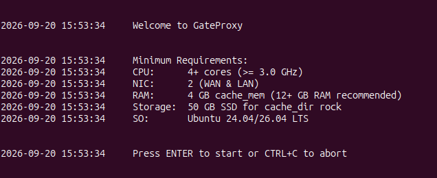

<!--
Gateproxy documentation
FILE: gateproxy/README.md
-->

# [Gateproxy](https://github.com/maravento)

[](https://github.com/maravento/vault)

<table width="100%">
  <tr>
    <td style="width: 50%; vertical-align: top;">
     <b>Gateproxy</b> centralizes internet access and the services of a LAN on one server. It is aimed at small and medium-sized businesses that need to control their traffic and administer their network. It integrates proxy, firewall, DHCP, DNS, Samba, traffic control, intrusion detection, backups and web administration tools through a common installer. Its modular design lets you choose services and use its independent projects separately or together.
    </td>
    <td style="width: 50%; vertical-align: top;">
     <b>Gateproxy</b> permite centralizar el acceso a Internet y los servicios de una LAN en un servidor. Está orientado a pequeñas y medianas empresas que necesitan controlar el tráfico y administrar su red. Integra proxy, firewall, DHCP, DNS, Samba, control de tráfico, detección de intrusiones, respaldos y herramientas de administración web mediante un instalador común. Su diseño modular permite elegir servicios y utilizar sus proyectos independientes por separado o conjuntamente.
    </td>
  </tr>
</table>

<!-- markdownlint-disable MD033 -->

## REQUIREMENTS

---

### Compatibility

<table width="100%">
  <tr>
    <td style="width: 50%; vertical-align: top;">
      Only tested on Ubuntu 24.04/26.04 LTS. Other versions or distributions are not tested and are used at your own risk.
    </td>
    <td style="width: 50%; vertical-align: top;">
      Solo probado en Ubuntu 24.04/26.04 LTS. Otras versiones o distribuciones no están probadas y se usan bajo tu responsabilidad.
    </td>
  </tr>
</table>

### Hardware

<table width="100%">
  <tr>
    <td style="width: 50%; vertical-align: top;">
      <ul><li>CPU: 4+ cores (≥ 3.0 GHz)</li><li>NIC: 2 (WAN &amp; LAN)</li><li>RAM: 12+ GB (4 GB cache_mem)</li><li>Storage: space for the 100000 MB rock cache, plus the operating system and other services</li></ul>
    </td>
    <td style="width: 50%; vertical-align: top;">
      <ul><li>CPU: 4+ núcleos (≥ 3.0 GHz)</li><li>Interfaces de red: 2 (WAN y LAN)</li><li>RAM: 12+ GB (4 GB cache_mem)</li><li>Almacenamiento: espacio para la caché rock de 100000 MB, además del sistema operativo y los demás servicios</li></ul>
    </td>
  </tr>
</table>

## REPOSITORY STRUCTURE

---

```
gateproxy/
├── acl/                        # Access control lists for MAC, Squid and iptables rules (see ACL STRUCTURE)
│
├── conf/
│   ├── fail2ban/
│   │   └── jail.local              # fail2ban jail config
│   ├── netplan/
│   │   └── 00-networkd.yaml        # Netplan configuration
│   ├── squid/
│   │   └── squid.conf              # Squid proxy configuration
│   ├── ttyd/
│   │   └── ttyd.service            # ttyd (web terminal) systemd unit
│   ├── unbound/
│   │   └── forward.conf            # Unbound DNS forwarder configuration
│   └── webmin/
│       └── text-editor.wbm         # Webmin Text Editor module
│
├── scr/                        # Scripts (deployed to /etc/scr/)
│   ├── bkconf.sh                   # Backup configuration files
│   ├── iptables.sh                 # Firewall rules and ipsets
│   ├── killswitch.sh               # Emergency traffic block
│   ├── serverboot.sh               # Start/restart all services
│   └── serviceswatch.sh            # Service watchdog
│
└── gpsetup.sh                  # Main installer script
```

## HOW TO USE

---

<table width="100%">
  <tr>
    <td style="width: 50%; vertical-align: top;">
     Run the following command on a fresh installation. The script must be executed as root or with <code>sudo</code>.
    </td>
    <td style="width: 50%; vertical-align: top;">
     Ejecute el siguiente comando en una instalación limpia. El script debe ejecutarse como root o con <code>sudo</code>.
    </td>
  </tr>
</table>

```bash
wget -qO gpsetup.sh https://raw.githubusercontent.com/maravento/vault/master/gateproxy/gpsetup.sh && sudo bash gpsetup.sh
```

### Interface Names

<table width="100%">
  <tr>
    <td style="width: 50%; vertical-align: top;">
     To identify the correct interface names before running the installer, use:
    </td>
    <td style="width: 50%; vertical-align: top;">
     Para identificar los nombres correctos de interfaces antes de ejecutar el instalador, use:
    </td>
  </tr>
</table>

```bash
join <(ip -o -br link | sort) <(ip -o -br addr | sort) | awk '$2=="UP" {print $1,$6,$3}' | sed -Ee 's./[0-9]+..'
```

### Shell Aliases

<table width="100%">
  <tr>
    <td style="width: 50%; vertical-align: top;">
     Added to <code>~/.bashrc</code> for the local user.
    </td>
    <td style="width: 50%; vertical-align: top;">
     Agregados al <code>~/.bashrc</code> del usuario local.
    </td>
  </tr>
</table>

```bash
alias upgrade   # full system upgrade (apt + aptitude + snap)
alias server    # run /etc/scr/serverboot.sh
alias cleaner   # run /etc/scr/cleaner.sh
```

### Verification

```bash
# Check running/failed services
systemctl list-units --type service --state running,failed

# Check iptables rules
iptables -nvL
iptables -nvL -t nat
iptables -nvL -t mangle

# Check active ipsets
ipset list -n

# Check listening sockets
ss -ltuna

# Check Squid cache
squidclient mgr:info

# Check WPAD/PAC
curl http://SERVER_IP:18800/wpad.pac
```

## HOW IT WORKS

---

### Installer Behavior

<table width="100%">
  <tr>
    <td style="width: 50%; vertical-align: top;">
      After installation, the installer waits for ENTER. It then removes the downloaded GateProxy directory, schedules its own deletion and reboots the system.
    </td>
    <td style="width: 50%; vertical-align: top;">
      Al terminar la instalación, el instalador espera que pulse ENTER. Después elimina el directorio descargado de GateProxy, programa su propia eliminación y reinicia el sistema.
    </td>
  </tr>
</table>



#### Conflict Checks

<table width="100%">
  <tr>
    <td style="width: 50%; vertical-align: top;">
     Before installing anything, the script checks for conflicting software already on the system. If any of the aborting checks are present, the installer aborts with instructions to remove them first.
    </td>
    <td style="width: 50%; vertical-align: top;">
     Antes de instalar nada, el script verifica que no haya software en conflicto ya presente. Si detecta alguno de los que abortan, el instalador aborta con instrucciones para removerlo primero.
    </td>
  </tr>
</table>

| Package or port | Description | Descripción |
| :--- | :--- | :--- |
| `python3` | Required dependency: abort installation if it is not installed | Dependencia requerida: abortar la instalación si no está instalado |
| UDP `67` | DHCP port in use, or the check cannot be completed: abort installation | Puerto DHCP ocupado, o la comprobación no puede completarse: abortar la instalación |
| `isc-dhcp-server`, `kea-dhcp4-server`, `udhcpd` | DHCP: abort installation | DHCP: abortar la instalación |
| `bind9`, `pdns-recursor`, `unbound` | DNS server: abort installation | Servidor DNS: abortar la instalación |
| `squid`, `squid3`, `squid-openssl` | Proxy: abort installation | Proxy: abortar la instalación |
| `apache2`, `nginx`, `lighttpd`, `caddy` | Web server: abort installation | Servidor web: abortar la instalación |
| `samba` | File server: abort installation | Servidor de archivos: abortar la instalación |
| `syslog-ng` | Syslog: abort installation | Syslog: abortar la instalación |
| `firewalld`, `fail2ban` | Firewall: abort installation | Firewall: abortar la instalación |
| `snort` | IDS: abort installation | IDS: abortar la instalación |
| `webmin`, `ttyd` | Web admin: abort installation | Administración web: abortar la instalación |
| `exim4` | Mail: abort installation | Correo: abortar la instalación |
| `ufw` | Active firewall: abort installation | Firewall activo: abortar la instalación |
| `dnsmasq` | DHCP/DNS overlap: show a warning | Superposición DHCP/DNS: mostrar una advertencia |

> `ntp`, `ntpdate`, `ntpsec` and `chrony` do not abort the installation. The installer removes them with `apt purge` and replaces them with `systemd-timesyncd`.
>
> `ntp`, `ntpdate`, `ntpsec` y `chrony` no abortan la instalación. El instalador los elimina con `apt purge` y los reemplaza por `systemd-timesyncd`.

#### Log Rotation

<table width="100%">
  <tr>
    <td style="width: 50%; vertical-align: top;">
     The installer adjusts two rotation policies it does not own. Both files are copied to <code>.bak</code> before being edited.
    </td>
    <td style="width: 50%; vertical-align: top;">
     El instalador ajusta dos políticas de rotación que no le pertenecen. Ambos archivos se copian a <code>.bak</code> antes de editarlos.
    </td>
  </tr>
</table>

| File | Value | Description | Descripción |
| :--- | :--- | :--- | :--- |
| `/etc/logrotate.d/squid` | `weekly` | Rotation frequency | Frecuencia de rotación |
| `/etc/logrotate.d/squid` | `rotate 7` | Rotated log files retained | Archivos de log rotados conservados |
| `/etc/logrotate.d/squid` | `create 0640 proxy proxy` | Permissions, owner and group of the recreated log | Permisos, propietario y grupo del log recreado |
| `/etc/logrotate.d/apache2` | `rotate 7` | Rotated log files retained; Ubuntu defaults to 14 | Archivos de log rotados conservados; Ubuntu utiliza 14 por defecto |

### Optional Temporary-Memory Mounts

| Function | Description | Descripción |
| :--- | :--- | :--- |
| Default state | These settings are optional and disabled in <code>gpsetup.sh</code>. By default, the installer preserves the existing mounts and adds none of these entries to <code>/etc/fstab</code>. | Estas opciones son voluntarias y están desactivadas en <code>gpsetup.sh</code>. Por defecto, el instalador conserva los montajes existentes y no agrega estas entradas a <code>/etc/fstab</code>. |
| Mount selection | Before running the installer, decide whether to enable an option or leave all disabled. For <code>/tmp</code>, choose either a 2 GB limit or 30% of physical RAM, never both. Check existing <code>fstab</code> entries to avoid duplicate mounts. The read-only <code>/run/shm</code> option is independent and can affect applications that write to shared memory. Files stored in tmpfs are lost on reboot. | Antes de ejecutar el instalador, decida si necesita alguna opción o prefiere mantenerlas todas desactivadas. Para <code>/tmp</code>, elija un límite de 2 GB o el 30 % de la RAM física, nunca ambos. Revise las entradas existentes de <code>fstab</code> para evitar montajes duplicados. La opción de <code>/run/shm</code> en solo lectura es independiente y puede afectar a las aplicaciones que escriben en memoria compartida. Los archivos almacenados en tmpfs se pierden al reiniciar. |
| Enable mounts | To enable an option, download the script and edit its optional mount block before executing it. For the 2 GB option, uncomment all three lines: <code>failure_message</code>, <code>grep</code> and <code>echo</code>. The examples below show the resulting <code>fstab</code> entries. | Para habilitar una opción, descargue el script y edite su bloque de montajes opcionales antes de ejecutarlo. Para la opción de 2 GB, descomente las tres líneas: <code>failure_message</code>, <code>grep</code> y <code>echo</code>. Los ejemplos siguientes muestran las entradas resultantes de <code>fstab</code>. |

```bash
tmpfs /tmp tmpfs defaults,size=2G,nofail,noatime,mode=1777 0 0      # /tmp as tmpfs, 2 GB limit / /tmp como tmpfs, límite de 2 GB
tmpfs /tmp tmpfs defaults,size=30%,nofail,noatime,mode=1777 0 0     # /tmp as tmpfs, 30% of RAM / /tmp como tmpfs, 30 % de la RAM
none /run/shm tmpfs defaults,ro 0 0                                 # read-only shared memory / memoria compartida de solo lectura
```

### Setup Parameters

<table width="100%">
  <tr>
    <td style="width: 50%; vertical-align: top;">
     During installation, the script will detect your network interfaces and ask you to confirm or replace the following default values. The selected mask determines the LAN prefix. Configuration files are adapted during installation; the PAC is generated by pydhcp.
    </td>
    <td style="width: 50%; vertical-align: top;">
     Durante la instalación, el script detectará sus interfaces de red y le pedirá confirmar o reemplazar los siguientes valores por defecto. La máscara elegida determina el prefijo LAN. Los archivos se adaptan durante la instalación; el PAC lo genera pydhcp.
    </td>
  </tr>
</table>

| Parameter | Default | Description | Descripción |
| :--- | :---: | :--- | :--- |
| WAN Interface | none (required) | Chosen from a numbered list of detected interfaces, with explicit `y/n` confirmation before continuing. Nothing is typed and there is no silent default | Se elige de una lista numerada de interfaces detectadas, con confirmación explícita `y/n` antes de continuar. No se escribe nada y no hay valor silencioso |
| LAN Interface | none (required) | Same numbered list and confirmation flow as the WAN interface. It cannot be the interface already assigned to WAN | Mismo flujo de lista numerada y confirmación que la interfaz WAN. No puede ser la interfaz ya asignada a WAN |
| Server IP | `192.168.0.10` | Gateway IP assigned to this server | IP del servidor en la LAN |
| Netmask | `255.255.255.0` | Configurable subnet mask. The CIDR prefix is derived from it; `/24` corresponds only to the default | Máscara de subred configurable. El prefijo CIDR se calcula desde ella; `/24` corresponde solo al valor inicial |
| DNS Primary | `1.1.1.2` | Primary DNS server | DNS primario |
| DNS Secondary | `1.0.0.2` | Secondary DNS server | DNS secundario |
| Proxy Port | `3128` | Squid proxy port | Puerto del proxy Squid |
| Squid Intercept Port | `3129` | Squid intercept port | Puerto transparente de Squid |

#### Where the Values Go

| Function | Description | Descripción |
| :--- | :--- | :--- |
| Localnet | Localnet (<code>192.168.0.0</code>) is derived from the Server IP and Netmask together, not asked separately. | Localnet (<code>192.168.0.0</code>) se deriva del Server IP y la Netmask en conjunto, no se pregunta por separado. |
| Client DNS | DNS Primary/Secondary configure Unbound forwarders. The firewall reads <code>SERV_DNS</code> from <code>pydhcp.env</code>, the same setting pydhcp uses for DHCP clients. Installation supplies the server IP as DNS to pydhcp. To change client DNS, edit that key, regenerate DHCP configuration and reload the affected services. | Los DNS Primario/Secundario configuran los reenviadores de Unbound. El firewall lee <code>SERV_DNS</code> desde <code>pydhcp.env</code>, la misma clave que pydhcp utiliza para los clientes DHCP. La instalación entrega a pydhcp la IP del servidor como DNS. Para cambiar los DNS de clientes, edita esa clave, regenera la configuración DHCP y recarga los servicios afectados. |
| Installer configuration | Require two connected wired interfaces. Ask WAN first among interfaces with global IPv4, then LAN among the remaining connected interfaces. Configure LAN through Netplan and verify its selected IPv4/prefix. Save only WAN in <code>gateproxy.env</code>. Other answers replace placeholders or are passed to module installers. Each module writes the same own keys it would write in a standalone installation. | Exige dos interfaces cableadas conectadas. Pregunta WAN primero entre interfaces con IPv4 global y después LAN entre las restantes conectadas. Configura LAN mediante Netplan y verifica su IPv4/prefijo seleccionado. Guarda únicamente WAN en <code>gateproxy.env</code>. Las otras respuestas sustituyen placeholders o se entregan a los instaladores de módulos. Cada módulo escribe las mismas claves propias que escribiría al instalarse por separado. |

#### gateproxy.env

<table width="100%">
  <tr>
    <td style="width: 50%; vertical-align: top;">
      The installer creates <code>/etc/gateproxy/gateproxy.env</code> after verifying the configured interfaces. Directory: root:root 750; file: root:root 640. It contains <code>WAN_IFACE</code> and <code>BACKUP_DIR</code>. The backup directory must be <code>/etc/bak/gateproxy</code> and is exclusive to <code>bkconf.sh</code>, which aborts on any other value and deletes other contents after publishing an archive. Other keys may be added when Gateproxy itself needs them; module-specific settings remain in their module configurations. The firewall reads DHCP settings from <code>pydhcp.env</code> and proxy ports from <code>proxymon.env</code> when installed. Files are parsed without executing their contents; each required key is checked in its owner file. <code>bkconf.sh</code> includes this directory in its backup. Subsequent changes are made in the configuration owned by the affected module.
    </td>
    <td style="width: 50%; vertical-align: top;">
      El instalador crea <code>/etc/gateproxy/gateproxy.env</code> después de verificar las interfaces configuradas. Directorio: root:root 750; archivo: root:root 640. Contiene <code>WAN_IFACE</code> y <code>BACKUP_DIR</code>. El directorio de respaldo debe ser <code>/etc/bak/gateproxy</code> y es exclusivo de <code>bkconf.sh</code>, que aborta con cualquier otro valor y elimina el resto del contenido tras publicar un respaldo. Se pueden añadir otras claves cuando el propio Gateproxy las necesite; los parámetros específicos de módulos permanecen en sus configuraciones. El firewall lee los datos DHCP desde <code>pydhcp.env</code> y los puertos del proxy desde <code>proxymon.env</code> cuando está instalado. Los archivos se interpretan sin ejecutar su contenido; cada clave requerida se comprueba en el archivo de su propietario. <code>bkconf.sh</code> incluye este directorio en su respaldo. Los cambios posteriores se realizan en la configuración propia del módulo afectado.
    </td>
  </tr>
</table>

```ini
# Network
WAN_IFACE=enp1s0

# Backup
BACKUP_DIR=/etc/bak/gateproxy
```

### Components

<table width="100%">
  <tr>
    <td style="width: 50%; vertical-align: top;">
     Gateproxy installs and configures the following components automatically.
    </td>
    <td style="width: 50%; vertical-align: top;">
     Gateproxy instala y configura los siguientes componentes automáticamente.
    </td>
  </tr>
</table>

#### Projects

| Project | Description | Descripción |
| :--- | :--- | :--- |
| [pydhcp](https://github.com/maravento/pydhcp) | DHCP server | Servidor DHCP |
| [smbstack](https://github.com/maravento/smbstack) | Samba file server | Servidor de archivos Samba |
| [proxymon](https://github.com/maravento/proxymon) | Bandwidth monitoring and quotas | Monitoreo de ancho de banda y cuotas |
| [suridata](https://github.com/maravento/vault/tree/master/suridata) | Suricata IDS with ipset blocking | IDS Suricata con bloqueo ipset |

> Each project is installed and configured by its own installer, and documents its own behavior, configuration and limits. Gateproxy only supplies the network values and consumes the results.
>
> Cada proyecto se instala y configura con su propio instalador, y documenta su comportamiento, configuración y límites. Gateproxy solo aporta los valores de red y consume los resultados.

#### Proxy

<table width="100%">
  <tr>
    <td style="width: 50%; vertical-align: top;">
     During installation, the Squid port configuration asks for both ports. Defaults: proxy <code>3128</code>, intercept <code>3129</code>. Gateproxy applies the selected ports to its configuration files and passes both values to Proxymon. Proxymon writes them as <code>SQUID_MGR_PORT</code> and <code>SQUID_INTERCEPT_PORT</code> in <code>proxymon.env</code>, without asking again.
    </td>
    <td style="width: 50%; vertical-align: top;">
     Durante la instalación, la configuración de puertos Squid pregunta ambos valores. Valores iniciales: proxy <code>3128</code>, transparente <code>3129</code>. Gateproxy aplica los puertos elegidos a sus archivos y pasa ambos valores a Proxymon. Proxymon los escribe como <code>SQUID_MGR_PORT</code> y <code>SQUID_INTERCEPT_PORT</code> en <code>proxymon.env</code>, sin volver a preguntar.
    </td>
  </tr>
</table>

##### Squid Port Validation

| Check | Description | Descripción |
|---|---|---|
| Reserved service ports | Both Squid ports reject `53`, `67`, `68`, `80`, `443`, `3092`, `18770`, `18771` and `18800`. GateProxy reserves these numbers for DNS, DHCP, Apache, SMBStack, Proxymon and WPAD. | Ambos puertos de Squid rechazan `53`, `67`, `68`, `80`, `443`, `3092`, `18770`, `18771` y `18800`. GateProxy reserva estos números para DNS, DHCP, Apache, SMBStack, Proxymon y WPAD. |
| Intercept port | `3129` is reserved for Squid interception. It is accepted in the intercept field and rejected in the explicit proxy field. Both selected ports must be distinct integers between 1 and 65535. | `3129` está reservado para la interceptación de Squid. Se acepta en el campo de interceptación y se rechaza en el campo del proxy explícito. Ambos puertos deben ser enteros distintos entre 1 y 65535. |
| Existing listeners | During port entry, a reserved or occupied TCP port prompts another attempt. Before applying the selected ports, the installer checks both again, including defaults. An occupied port or failed socket query aborts before port substitution. | Durante la selección, un puerto reservado u ocupado por TCP provoca otro intento. Antes de aplicar los puertos elegidos, el instalador comprueba ambos nuevamente, incluidos los predeterminados. Un puerto ocupado o una consulta de sockets fallida detiene la instalación antes de sustituir puertos. |

##### Proxy and PAC Ports

| Component | Port | Description | Descripción |
| :--- | :---: | :--- | :--- |
| Squid (squid-openssl) | `3128` | Explicit proxy with rock/ufs cache | Proxy explícito con caché rock/ufs |
| Squid (squid-openssl) | `3129` | Intercept port for captive-portal probes and clients not using the PAC, filtered by the same ACLs | Puerto transparente para sondeos de portal cautivo y clientes sin PAC, filtrados por las mismas ACL |
| WPAD/PAC (Apache2) | `18800` | Proxy auto-config served via `wpad.pac` | Autoconfiguración de proxy servida por `wpad.pac` |
| Proxymon | `18770` | Bandwidth monitoring dashboard | Panel de monitoreo de ancho de banda |
| Proxymon | `18771` | Bandwidth quota warning page (bandata redirect) | Página de aviso de cuota (redirección de bandata) |

#### Web / Admin

| Component | Port | Description | Descripción |
| :--- | :---: | :--- | :--- |
| Apache2 | `80` | Web server with PHP support and administration pages; WPAD uses its own listener on port 18800 | Servidor web con PHP y páginas de administración; WPAD utiliza su propia escucha en el puerto 18800 |
| Webmin | `10000` | Server administration panel (`https://localhost:10000`) | Panel de administración del servidor (`https://localhost:10000`) |
| Webmin: Text Editor | `10000` | Edit ACL files from the browser | Editar archivos ACL desde el navegador |
| Webmin: Service Monitor (`servicemon`) | `10000` | Watch and restart services | Monitorear y reiniciar servicios |
| Webmin: Netplan Manager (`netplanmgr`) | `10000` | Manage network configuration | Gestionar configuración de red |

#### DHCP

| Component | Config | Description | Descripción |
| :--- | :--- | :--- | :--- |
| pydhcp | `/etc/pydhcp/core/pydhcpd.conf` | Python-based DHCP server; default pool range 220–235 | Servidor DHCP en Python; rango de pool inicial 220–235 |

> Pool range and other DHCP settings can be changed in `/etc/pydhcp/pydhcp.env` after installation.
>
> El rango del pool y otros parámetros DHCP pueden modificarse en `/etc/pydhcp/pydhcp.env` luego de la instalación.

#### DNS

| Component | Config | Description | Descripción |
| :--- | :--- | :--- | :--- |
| Unbound | `/etc/unbound/unbound.conf.d/forward.conf` | Forwarding resolver, not recursive. Listens on `127.0.0.1` and the server IP, and forwards to `1.1.1.2`, `1.0.0.2` and `9.9.9.9` by default. DHCP clients receive the server IP as their DNS server. | Resolutor de reenvío, no recursivo. Escucha en `127.0.0.1` y en la IP del servidor, y reenvía a `1.1.1.2`, `1.0.0.2` y `9.9.9.9` de forma predeterminada. Los clientes DHCP reciben la IP del servidor como su DNS. |

#### Security / Monitoring

| Component | Port | Description | Descripción |
| :--- | :---: | :--- | :--- |
| Suricata IDS | — | Intrusion detection in AF-PACKET mode with auto-update rules; community-id enabled | Detección de intrusiones en modo AF-PACKET con reglas autoactualizadas; community-id activo |
| suridata | — | Turns `drop.conf` matches into blocks through the `suridata` ipset; cron every 5 minutes | Convierte las coincidencias de `drop.conf` en bloqueos mediante el ipset `suridata`; cron cada 5 minutos |
| EveBox | `5636` | Suricata event browser (`http://localhost:5636`) | Visor de eventos de Suricata (`http://localhost:5636`) |
| fail2ban | — | Brute-force protection with custom jail config | Protección contra fuerza bruta con jaulas propias |
| ttyd | `7681` | Web terminal, loopback only (`http://localhost:7681`) | Terminal web, solo en loopback (`http://localhost:7681`) |

#### Net Tools

<table width="100%">
  <tr>
    <td style="width: 50%; vertical-align: top;">
     Command-line tools for the administrator. No script of the stack invokes them.
    </td>
    <td style="width: 50%; vertical-align: top;">
     Herramientas de línea de comandos para el administrador. Ningún script del stack las invoca.
    </td>
  </tr>
</table>

| Tool | Purpose | Propósito |
| :--- | :--- | :--- |
| `iw` | Wireless interfaces (`iwconfig`, `iwlist`, `iwpriv`) | Interfaces inalámbricas (`iwconfig`, `iwlist`, `iwpriv`) |
| `fping`, `ethtool` | Host reachability and NIC settings | Alcance de hosts y ajustes de la tarjeta de red |
| `iperf3` | Throughput test (server: `iperf3 -s`, client: `iperf3 -c SERVER_IP`) | Prueba de rendimiento (servidor: `iperf3 -s`, cliente: `iperf3 -c SERVER_IP`) |
| `masscan`, `nmap`, `python3-nmap`, `ndiff` | Port scanning and scan comparison | Escaneo de puertos y comparación de escaneos |
| `nbtscan`, `nast`, `arp-scan`, `arping`, `netdiscover` | LAN discovery over NetBIOS and ARP | Descubrimiento de la LAN por NetBIOS y ARP |
| `traceroute`, `mtr-tiny` | Path tracing to a domain or IP | Trazado de ruta hacia un dominio o IP |

#### Backup

| Component | Description | Descripción |
| :--- | :--- | :--- |
| Timeshift | System snapshots | Instantáneas del sistema |
| FreeFileSync | File mirror sync, updated weekly by `/etc/scr/ffsupdate.sh` | Sincronización espejo de archivos, actualizada cada semana por `/etc/scr/ffsupdate.sh` |
| `bkconf.sh` | `scr/` | manual; monthly with `--install` | Creates a configuration ZIP in `BACKUP_DIR` and retains three archives. `--install` registers its monthly task; `--uninstall` removes that task | Crea un ZIP de configuración en `BACKUP_DIR` y conserva tres respaldos. `--install` registra su tarea mensual; `--uninstall` elimina esa tarea |

#### ACL Structure

| Function | Description | Descripción |
| :--- | :--- | :--- |
| ACL deployment | Squid lists live in <code>/etc/squid/acl/</code>. Administrator lists live in <code>/etc/acl/</code>. Templates are copied only when missing. Webmin Text Editor lists the MAC files. | Las listas de Squid están en <code>/etc/squid/acl/</code>. Las del administrador están en <code>/etc/acl/</code>. Las plantillas solo se copian si faltan. Text Editor de Webmin lista los archivos MAC. |
| MAC entry format | MAC list files use pydhcp's own entry format: <code>a;MAC;IP;HOSTNAME;</code>. The leading <code>a</code> marks an active entry — <code>iptables.sh</code> only reads lines starting with <code>a;</code> and a non-empty MAC field; anything else (including a different leading character or a commented-out <code>#a;...</code> line) is ignored. | Los archivos de listas MAC usan el mismo formato de entrada que pydhcp: <code>a;MAC;IP;HOSTNAME;</code>. La <code>a</code> inicial marca una entrada activa — <code>iptables.sh</code> sólo lee líneas que empiecen con <code>a;</code> y tengan el campo MAC no vacío; cualquier otra cosa (incluido un carácter inicial distinto o una línea comentada <code>#a;...</code>) se ignora. |

```
/etc/acl/
├── mac-limited.txt
├── mac-unlimited.txt
├── blockports.txt
└── bogons.txt

/etc/squid/acl/
├── aipextra.txt
├── allowdomains.txt
├── blockdomains.txt
├── blockext.txt
├── blockmime.txt
└── blockpatterns.txt
```

> Suricata's blocklist (`suridata.txt`) is not under `/etc/acl/`: it lives in `/etc/suricata/acl/suridata.txt`, generated by `suridata.sh`. MACs blocked from a DHCP lease (`blockdhcp.txt`) belong to pydhcp and live at `/etc/pydhcp/acl/blockdhcp.txt`.
>
> La lista de bloqueo de Suricata (`suridata.txt`) no está en `/etc/acl/`: vive en `/etc/suricata/acl/suridata.txt`, generada por `suridata.sh`. Las MAC bloqueadas por concesión DHCP (`blockdhcp.txt`) pertenecen a pydhcp y viven en `/etc/pydhcp/acl/blockdhcp.txt`.

#### Firewall

<table width="100%">
  <tr>
    <td style="width: 50%; vertical-align: top;">
     The firewall (<code>iptables.sh</code>) uses an O(1) ipset-based architecture. Every LAN device is identified by MAC+IP binding derived from the DHCP server config. Global IPv4 policy is permissive with explicit drops; IPv6 is closed by default on LAN.
    </td>
    <td style="width: 50%; vertical-align: top;">
     El firewall (<code>iptables.sh</code>) usa una arquitectura basada en ipset O(1). Cada dispositivo LAN es identificado por enlace MAC+IP derivado de la configuración del servidor DHCP. La política IPv4 global es permisiva con drops explícitos; IPv6 está cerrado por defecto en LAN.
    </td>
  </tr>
</table>

| Component | Config | Description | Descripción |
| :--- | :--- | :--- | :--- |
| iptables + ipset | `/etc/scr/iptables.sh` | Stateful firewall with MAC-based access control | Firewall con estado y control de acceso por MAC |
| ulogd2 | `/var/log/ulog/syslogemu.log` | Kernel-level packet logging via NFLOG | Registro de paquetes a nivel de kernel mediante NFLOG |

##### ipsets

| ipset | Type | Description | Descripción |
| :--- | :--- | :--- | :--- |
| `macunlimited` | `hash:mac` | Full bypass for APs, managed switches and similar infrastructure. It also **requires a matching static reservation in `pydhcpd.conf`**, because `MACCHECK` checks `macip`, not this list | Acceso total para APs, switches administrables e infraestructura similar. Además **exige una reserva estática en `pydhcpd.conf`**, porque `MACCHECK` consulta `macip`, no esta lista |
| `maclimited` | `hash:mac` | Routed through Squid: explicit via PAC (port 3128, served on 18800), or intercepted (port 3129) for HTTP without PAC. Same reservation requirement as `macunlimited` | Enrutados por Squid: explícito por PAC (puerto 3128, servido en 18800), o transparente (puerto 3129) para HTTP sin PAC. Misma exigencia de reserva que `macunlimited` |
| `macports` | `list:set` | Groups other MAC sets for shared service rules. Its current member is `maclimited`. The same static-reservation requirement applies. | Agrupa otros conjuntos de MAC para compartir reglas de servicios. Su miembro actual es `maclimited`. Se aplica el mismo requisito de reserva estática. |
| `macip` | `hash:ip,mac` | <ul><li>MAC and IP binding, built from the static <code>host {}</code> blocks in <code>pydhcpd.conf</code>, not directly from <code>mac-*.txt</code>.</li><li>Adding a MAC to <code>mac-unlimited.txt</code> or <code>mac-limited.txt</code> classifies it but does <strong>not</strong> grant network access by itself.</li><li>A device without a matching static reservation is dropped by <code>MACCHECK</code> before the other lists are evaluated.</li><li>pydhcp provides <code>tools/pyleases.sh</code> to generate those reservations from the same <code>mac-*.txt</code> files.</li><li>Run it after editing any of them, or add the reservation by hand; no installer schedules it.</li></ul> | <ul><li>Enlace MAC e IP, construido desde los bloques estáticos <code>host {}</code> de <code>pydhcpd.conf</code>, no directamente desde <code>mac-*.txt</code>.</li><li>Agregar una MAC a <code>mac-unlimited.txt</code> o <code>mac-limited.txt</code> la clasifica, pero <strong>no</strong> concede acceso a la red por sí solo.</li><li>Un dispositivo sin reserva estática coincidente se descarta mediante <code>MACCHECK</code> antes de evaluar las demás listas.</li><li>pydhcp proporciona <code>tools/pyleases.sh</code> para generar esas reservas desde los mismos archivos <code>mac-*.txt</code>.</li><li>Ejecútalo después de editar cualquiera de ellos, o agrega la reserva a mano; ningún instalador lo programa.</li></ul> |
| `blockports` | `bitmap:port` | Blocked port numbers (VPN tunnels, P2P, cryptomining, legacy protocols) | Números de puertos bloqueados (túneles VPN, P2P, criptominería, protocolos obsoletos) |
| `suridata` | `hash:ip` | Destination IPs flagged by Suricata alerts matching a `drop.conf` signature; silent `DROP` | IP de destino marcadas por alertas de Suricata que coinciden con `drop.conf`; `DROP` silencioso |
| `bandata` | `hash:ip` | IPs over bandwidth quota, left with DNS and port 80 only and redirected to a warning page. Proxymon creates and fills it, not `iptables.sh`, which only opens port 18771 for the warning page | IP que superaron la cuota, con solo DNS y puerto 80, redirigidas a una página de aviso. La crea y llena Proxymon, no `iptables.sh`, que solo abre el puerto 18771 para esa página |

##### Blocked Ports (`blockports.txt`)

<table width="100%">
  <tr>
    <td style="width: 50%; vertical-align: top;">
     <code>blockports.txt</code> holds the ports blocked outbound from the LAN by default, one per line. They cover VPNs and tunnels, P2P, cryptomining, Tor, alternate proxies and legacy or risky protocols. The list is the ACL itself, so consult the file for the current entries.
    </td>
    <td style="width: 50%; vertical-align: top;">
     <code>blockports.txt</code> contiene los puertos bloqueados por defecto en tráfico saliente desde la LAN, uno por línea. Cubren VPN y túneles, P2P, criptominería, Tor, proxies alternativos y protocolos antiguos o riesgosos. La lista es la ACL misma, así que las entradas vigentes se consultan en el archivo.
    </td>
  </tr>
</table>

##### Suricata-driven IP Blocking (`suridata`)

| Function | Description | Descripción |
| :--- | :--- | :--- |
| Alert processing | Suricata records alerts in IDS mode. Every five minutes, `suridata.sh` processes alerts whose SIDs have a `drop` action in the generated rules. It adds destination IPs to `suridata.txt`, updates the `suridata` ipset and inserts its own NFLOG and DROP rules at the start of mangle PREROUTING. These rules apply to the LAN interface without a MAC-group exemption. After `iptables.sh` clears the tables, the next `suridata.sh` run reinstalls them. | Suricata registra alertas en modo IDS. Cada cinco minutos, `suridata.sh` procesa las alertas cuyas SID tienen acción `drop` en las reglas generadas. Añade las IP de destino a `suridata.txt`, actualiza el ipset `suridata` e inserta sus propias reglas NFLOG y DROP al inicio de mangle PREROUTING. Estas reglas se aplican a la interfaz LAN sin una excepción por grupo MAC. Después de que `iptables.sh` vacía las tablas, la siguiente ejecución de `suridata.sh` las reinstala. |
| Rule updates | <ul><li><b>Editing <code>drop.conf</code> / <code>disable.conf</code>:</b> <code>suricataupdate.sh</code> is the only script that reads these files and applies them to <code>suricata.rules</code>; it only runs once a day via cron (2 AM).</li><li>A SID you just added to <code>drop.conf</code> stays as plain <code>alert</code> (not blocked) until that cron runs.</li><li>To apply the change immediately, run both in order: <code>sudo /etc/suricata/suricataupdate.sh && sudo /etc/suricata/suridata.sh</code> — on that first <code>suridata.sh</code> run after the SID becomes <code>drop</code>, it also does a one-time full <code>eve.json</code> rescan for that SID (tracked via <code>suridata.sids</code>), so alerts that already fired earlier that day get backfilled into <code>suridata.txt</code> too, not just alerts from that point forward.</li></ul> | <ul><li><b>Al editar <code>drop.conf</code> / <code>disable.conf</code>:</b> <code>suricataupdate.sh</code> es el único script que lee estos archivos y los aplica a <code>suricata.rules</code>; corre una sola vez al día por cron (2 AM).</li><li>Una SID recién agregada a <code>drop.conf</code> queda como <code>alert</code> plano (sin bloquear) hasta que corra ese cron.</li><li>Para aplicar el cambio de inmediato, corre ambos en orden: <code>sudo /etc/suricata/suricataupdate.sh && sudo /etc/suricata/suridata.sh</code> — en esa primera corrida de <code>suridata.sh</code> después de que la SID pasa a <code>drop</code>, también hace un escaneo completo único de <code>eve.json</code> para esa SID (rastreado vía <code>suridata.sids</code>), así que las alertas que ya habían ocurrido ese mismo día también quedan agregadas a <code>suridata.txt</code>, no solo las de ahí en adelante.</li></ul> |
| Live blocking | Between reloads, <code>suridata.sh</code> also patches the live <code>suridata</code> ipset directly with any newly found IP, so a new block takes effect within one cron cycle instead of waiting for the next full firewall reload. | Entre recargas, <code>suridata.sh</code> también aplica directamente al ipset <code>suridata</code> en vivo cualquier IP recién encontrada, para que un nuevo bloqueo surta efecto en el mismo ciclo de cron, sin esperar la siguiente recarga completa del firewall. |
| Log cleanup | <b>Log cleanup:</b> <code>suricataclean.sh</code> runs monthly via cron and truncates Suricata's own logs. It is the third and last cron entry of the Suricata component, alongside <code>suricataupdate.sh</code> (daily, 2 AM) and <code>suridata.sh</code> (every 5 minutes). | <b>Limpieza de logs:</b> <code>suricataclean.sh</code> corre por cron una vez al mes y trunca los logs propios de Suricata. Es la tercera y última entrada de cron del componente Suricata, junto a <code>suricataupdate.sh</code> (diaria, 2 AM) y <code>suridata.sh</code> (cada 5 minutos). |
| Local exclusion | <ul><li><b>Local exclusion:</b> Suridata reads <code>SERV_SUBNET</code>, <code>SERV_MASK</code> and <code>WAN_IFACE</code> from <code>/etc/suricata/data/suridata.env</code>.</li><li>It excludes the complete configured LAN network and current WAN IPv4 networks, using their actual masks.</li><li>No <code>/24</code> is assumed.</li><li>Matching addresses already present are removed from the blocklist and live ipset.</li><li>Missing or invalid required network settings abort execution.</li><li>Suridata validates LAN/WAN IPv4 before installing its packages.</li><li>If runtime WAN IPv4 detection fails, it aborts before changing blocks; existing blocks remain unchanged.</li></ul> | <ul><li><b>Exclusión local:</b> Suridata lee <code>SERV_SUBNET</code>, <code>SERV_MASK</code> y <code>WAN_IFACE</code> desde <code>/etc/suricata/data/suridata.env</code>.</li><li>Excluye la red LAN completa y las redes IPv4 WAN actuales mediante sus máscaras reales.</li><li>No asume <code>/24</code>.</li><li>Retira direcciones coincidentes de la lista y del ipset activo.</li><li>Aborta si faltan ajustes de red requeridos o son inválidos.</li><li>Suridata valida IPv4 LAN/WAN antes de instalar sus paquetes.</li><li>Si falla detectar IPv4 WAN durante la ejecución, aborta antes de modificar bloqueos; conserva los existentes.</li></ul> |

##### Security Rules

<table width="100%">
  <tr>
    <td style="width: 50%; vertical-align: top;">
      <ul><li>SYN flood protection via rate-limited <code>syn_flood</code> chain</li><li>TCP scan and malformed packet drops (SYN+FIN, SYN+RST, NEW with SYN+ACK)</li><li>Bittorrent, Tor and other protocol-level detection is handled by Suricata, not by hex-string matching in <code>iptables.sh</code></li><li>GRE (protocol 47) and 6to4 (protocol 41) blocked from LAN</li><li>Windows ICS network range (<code>192.168.137.0/24</code>) blocked</li><li>NetBIOS NMBD (137–139), CoAP (5683–5684), mDNS noise and WUDO WAN traffic blocked</li><li>Bogon and reserved-range filtering (RFC1918, link-local, test-nets) is available in <code>iptables.sh</code> but <strong>disabled by default</strong>. Enabling it blindly can lock the LAN out of its own network when the server's subnet falls inside a blocked RFC1918 range. Read the comment above the <code>BOGONS</code> block first.</li></ul>
    </td>
    <td style="width: 50%; vertical-align: top;">
      <ul><li>Protección contra SYN flood mediante la cadena <code>syn_flood</code> con límite de tasa</li><li>Descarte de escaneos TCP y paquetes mal formados (SYN+FIN, SYN+RST, NEW con SYN+ACK)</li><li>La detección de Bittorrent, Tor y otros protocolos la hace Suricata, no la coincidencia hexadecimal en <code>iptables.sh</code></li><li>GRE (protocolo 47) y 6to4 (protocolo 41) bloqueados desde la LAN</li><li>Rango de red de Windows ICS (<code>192.168.137.0/24</code>) bloqueado</li><li>NetBIOS NMBD (137–139), CoAP (5683–5684), ruido mDNS y tráfico WUDO hacia WAN bloqueados</li><li>El filtrado de bogones y rangos reservados (RFC1918, link-local, test-nets) existe en <code>iptables.sh</code> pero está <strong>desactivado por defecto</strong>. Activarlo a ciegas puede dejar la LAN fuera de su propia red si la subred del servidor cae en un rango RFC1918 bloqueado. Lee antes el comentario sobre el bloque <code>BOGONS</code>.</li></ul>
    </td>
  </tr>
</table>

##### Allowed LAN Services (`macports`)

<table width="100%">
  <tr>
    <td style="width: 50%; vertical-align: top;">
     Devices registered in <code>macports</code> have access to the services below. DNS (UDP/TCP 53) is a global rule applied to all LAN traffic, not a <code>macports</code> privilege; see <code>SERV_DNS</code> above.
    </td>
    <td style="width: 50%; vertical-align: top;">
     Los dispositivos registrados en <code>macports</code> tienen acceso a los servicios de abajo. DNS (UDP/TCP 53) es una regla global aplicada a todo el tráfico LAN, no un privilegio de <code>macports</code>; ver <code>SERV_DNS</code> arriba.
    </td>
  </tr>
</table>

<table width="100%">
  <tr><th>Service / Servicio</th><th>Ports / Puertos</th></tr>
  <tr><td>Printing / Impresión</td><td>JetDirect/RAW 9100, SNMP 161–162, prnrequest/prnstatus 3910–3911</td></tr>
  <tr><td>Email / Correo</td><td>SMTP 465, 587; IMAP 993; POP3 995; STARTTLS 143, 110</td></tr>
  <tr><td>Messaging / XMPP / Mensajería / XMPP</td><td>5222, 5223, 5228, 5269</td></tr>
  <tr><td>WebRTC / STUN-TURN / WebRTC / STUN-TURN</td><td>UDP 3478–3481, 19302–19309; TCP 3478, 5349</td></tr>
  <tr><td>Samba / SMB / Samba / SMB</td><td>TCP 445; the SMBStack panel on 3092 listens on loopback only / TCP 445; el panel SMBStack en 3092 escucha solo en loopback</td></tr>
  <tr><td>LAN discovery / Descubrimiento LAN</td><td>mDNS 5353, LLMNR 5355, SSDP/UPnP 1900, WSD 3702, IGMP</td></tr>
  <tr><td>KMS / KMS</td><td>Windows activation 1688</td></tr>
</table>

### Optional Packages

<table width="100%">
  <tr>
    <td style="width: 50%; vertical-align: top;">
     The installer offers three optional installation prompts at the end of the base setup.
    </td>
    <td style="width: 50%; vertical-align: top;">
     El instalador ofrece tres prompts de instalación opcionales al final de la configuración base.
    </td>
  </tr>
</table>

#### Optional GTK Pack

<table width="100%">
  <tr>
    <td style="width: 50%; vertical-align: top;">
     Desktop applications. Only useful on a machine with a graphical session.
    </td>
    <td style="width: 50%; vertical-align: top;">
     Aplicaciones de escritorio. Solo útiles en una máquina con sesión gráfica.
    </td>
  </tr>
</table>

| Package | Description | Descripción |
| :--- | :--- | :--- |
| `gparted` | Partition editor | Editor de particiones |
| `gnome-disk-utility` | GNOME disk manager | Gestor de discos de GNOME |
| `qdirstat` | Disk usage analyzer | Analizador de uso de disco |
| `baobab` | Disk usage analyzer (GNOME) | Analizador de uso de disco (GNOME) |
| `gsmartcontrol` | GUI for SMART disk health | Interfaz gráfica para la salud SMART |
| `cpu-x` | Hardware information viewer | Visor de información de hardware |
| `synaptic` | Graphical package manager | Gestor gráfico de paquetes |
| `gdebi` | Graphical `.deb` installer | Instalador gráfico de `.deb` |
| `gtkhash` | Checksum calculator | Calculadora de sumas de verificación |
| `wmctrl` | Window manager control | Control del gestor de ventanas |
| `mesa-utils` | OpenGL diagnostics (`glxinfo`, `glxgears`) | Diagnóstico de OpenGL (`glxinfo`, `glxgears`) |
| `fsearch` | Fast file search; adds an external PPA | Búsqueda rápida de archivos; agrega un PPA externo |
| `lynis` | Security auditing (`lynis -c -Q`; log at `/var/log/lynis.log`) | Auditoría de seguridad (`lynis -c -Q`; log en `/var/log/lynis.log`) |

#### Optional Pack: Samba

<table width="100%">
  <tr>
    <td style="width: 50%; vertical-align: top;">
     Installs <b>smbstack</b> — a Samba server with a shared folder, Recycle Bin, and audit logging configured out of the box. <code>smbstack</code> manages its own veto list for common unwanted file types (<code>/etc/smbstack/acl/commonveto.txt</code>, active by default) — not gateproxy's responsibility.
    </td>
    <td style="width: 50%; vertical-align: top;">
     Instala <b>smbstack</b> — un servidor Samba con carpeta compartida, Papelera de Reciclaje y registro de auditoría configurados de fábrica. <code>smbstack</code> gestiona su propia lista veto de tipos de archivo comunes no deseados (<code>/etc/smbstack/acl/commonveto.txt</code>, activa por defecto) — no es responsabilidad de gateproxy.
    </td>
  </tr>
</table>

#### Optional Pack: UHM

<table width="100%">
  <tr>
    <td style="width: 50%; vertical-align: top;">
      <ul><li>This prompt only appears if a local UniFi Network controller is detected first — classic (<code>dpkg</code> package <code>unifi</code>) or unifi-os (<code>/var/lib/uosserver/server.conf</code>, podman-based).</li><li>If neither is found, the prompt is skipped entirely — gateproxy does not install UniFi or podman itself.</li><li>To install UniFi Network self-hosted / UniFi OS Server first, use <a href="https://raw.githubusercontent.com/maravento/vault/refs/heads/master/scripts/bash/unifisetup.sh"><code>unifisetup.sh</code></a>, then run <code>uhmsetup.sh</code> from the <a href="https://github.com/maravento/uhm">uhm</a> repository.</li><li>Installs <b>UniFi Host Manager (UHM)</b>, which requires pydhcp already installed and running — a requirement gateproxy's own base setup already satisfies. <code>uhm</code> runs its own interactive installer (<code>uhmsetup.sh</code>): it reads pydhcp's network values from <code>pydhcp.env</code> automatically, then prompts for its own UniFi-specific settings (controller credentials, SSID, etc.) directly.</li></ul>
    </td>
    <td style="width: 50%; vertical-align: top;">
      <ul><li>Este prompt sólo aparece si primero se detecta un controlador UniFi Network local — classic (paquete <code>dpkg</code> <code>unifi</code>) o unifi-os (<code>/var/lib/uosserver/server.conf</code>, basado en podman).</li><li>Si no se detecta ninguno, el prompt se omite por completo — gateproxy no instala UniFi ni podman por sí mismo.</li><li>Para instalar primero UniFi Network self-hosted / UniFi OS Server, use <a href="https://raw.githubusercontent.com/maravento/vault/refs/heads/master/scripts/bash/unifisetup.sh"><code>unifisetup.sh</code></a>, y luego ejecute <code>uhmsetup.sh</code> desde el repositorio de <a href="https://github.com/maravento/uhm">uhm</a>.</li><li>Instala <b>UniFi Host Manager (UHM)</b>, que requiere tener pydhcp ya instalado y corriendo — requisito que la configuración base de gateproxy ya satisface. <code>uhm</code> ejecuta su propio instalador interactivo (<code>uhmsetup.sh</code>): lee automáticamente los valores de red de pydhcp desde <code>pydhcp.env</code>, y luego pregunta directamente por sus propios parámetros específicos de UniFi (credenciales del controlador, SSID, etc.).</li></ul>
    </td>
  </tr>
</table>

### Post-Install

#### Scripts (`/etc/scr/`)

<table width="100%">
  <tr>
    <td style="width: 50%; vertical-align: top;">
      The installer copies project scripts from <code>scr/</code> to <code>/etc/scr/</code> and downloads the external scripts listed below.
    </td>
    <td style="width: 50%; vertical-align: top;">
      El instalador copia los scripts del proyecto desde <code>scr/</code> a <code>/etc/scr/</code> y descarga los scripts externos enumerados abajo.
    </td>
  </tr>
</table>

| Script | Source / Origen | Trigger | Description | Descripción |
| :--- | :--- | :--- | :--- | :--- |
| `iptables.sh` | `scr/` | manual | Load firewall rules and ipsets. Some deployed tools — <code>iptables.sh</code> here, and pydhcp's own <code>pyleases.sh</code> — are never added to cron automatically by any installer. Scheduling them (or not) is entirely up to the operator, based on their own needs. | Carga las reglas del firewall y los ipsets. Algunas herramientas desplegadas — <code>iptables.sh</code> aquí, y <code>pyleases.sh</code> de pydhcp — nunca se agregan al cron automáticamente por ningún instalador. Programarlas (o no) queda enteramente a criterio del operador, según sus necesidades. |
| `serverboot.sh` | `scr/` | manual (`alias server`) | Waits for network readiness, reloads DHCP and Squid, then restarts Apache, available Samba services and rsyslog. Reports failures | Espera que la red esté disponible, recarga DHCP y Squid, y reinicia Apache, los servicios Samba disponibles y rsyslog. Informa los fallos |
| `serviceswatch.sh` | `scr/` | every 5 min | Checks Webmin, Apache, Squid and rsyslog processes and attempts recovery when absent | Comprueba los procesos de Webmin, Apache, Squid y rsyslog e intenta recuperarlos cuando están ausentes |
| `killswitch.sh` | `scr/` | manual | Block all traffic in an emergency | Bloquea todo el tráfico en una emergencia |
| `bkconf.sh` | `scr/` | manual; monthly with `--install` | Creates a configuration ZIP in `BACKUP_DIR` and retains three archives. `--install` registers its monthly task; `--uninstall` removes that task | Crea un ZIP de configuración en `BACKUP_DIR` y conserva tres respaldos. `--install` registra su tarea mensual; `--uninstall` elimina esa tarea |
| `hwclock.sh` | external / externo | `@reboot` | Sync hardware clock | Sincroniza el reloj de hardware |
| `blackusb.sh` | external / externo | `@reboot` | USB device access control. The cron entry runs `blackusb.sh --off`, so the udev rule is moved aside on every boot and the control starts deactivated. Activate it with `blackusb.sh --on` | Control de acceso a dispositivos USB. La entrada de cron ejecuta `blackusb.sh --off`, así que la regla udev se aparta en cada arranque y el control queda desactivado. Actívalo con `blackusb.sh --on` |
| `cleaner.sh` | external / externo | `@weekly` | System cleanup | Limpieza del sistema |
| `ffsupdate.sh` | external / externo | `@weekly` | Update FreeFileSync | Actualiza FreeFileSync |
| `filereport.sh` | external / externo | manual | Generate file system report | Genera un informe del sistema de archivos |

### WPAD/PAC Integration

| Aspect | Description | Descripción |
|---|---|---|
| Deployment | GateProxy configures its interfaces before invoking PyDHCP. It passes `PYDHCP_LAN_IFACE` and `PYDHCP_SERVER_IP` and answers the WPAD/PAC prompt with `y`. PyDHCP deploys Apache’s WPAD VirtualHost and `/var/www/wpad/wpad.pac`. | GateProxy configura sus interfaces antes de invocar PyDHCP. Pasa `PYDHCP_LAN_IFACE` y `PYDHCP_SERVER_IP` y responde `y` a la pregunta sobre WPAD/PAC. PyDHCP despliega el VirtualHost WPAD de Apache y `/var/www/wpad/wpad.pac`. |
| PAC generation and proxy port | PyDHCP generates the PAC according to Squid’s availability at that moment. LAN destinations, local names and loopback use direct connections. Later, when GateProxy applies its Squid configuration, it replaces port `3128` in an existing `PROXY` entry with the selected proxy port. A PAC containing only `DIRECT` retains that content. | PyDHCP genera el PAC según la disponibilidad de Squid en ese momento. Los destinos LAN, nombres locales y loopback utilizan conexiones directas. Después, cuando GateProxy aplica su configuración de Squid, sustituye el puerto `3128` de una entrada `PROXY` existente por el puerto proxy seleccionado. Un PAC que contiene solamente `DIRECT` conserva ese contenido. |
| DHCP advertisement | PyDHCP enables WPAD after a complete PAC download with HTTP `200`. `pyleases.sh`, or `uhmleases.sh` when UHM manages DHCP reconstruction, repeats that check before generating option 252. | PyDHCP habilita WPAD tras descargar el PAC completo con HTTP `200`. `pyleases.sh`, o `uhmleases.sh` cuando UHM gestiona la reconstrucción DHCP, repite esa comprobación antes de generar la opción 252. |
| Firewall access | `iptables.sh` reads `WPAD_PORT` from `pydhcp.env`. It allows PAC access for `mac-limited` clients and blocks new connections from `mac-unlimited` clients to the proxy and PAC ports. | `iptables.sh` lee `WPAD_PORT` de `pydhcp.env`. Permite el acceso al PAC para clientes `mac-limited` y bloquea conexiones nuevas desde clientes `mac-unlimited` a los puertos del proxy y del PAC. |

### Manual Configuration Changes

<table width="100%">
  <tr>
    <td style="width: 50%; vertical-align: top;">
      During installation, <code>gpsetup.sh</code> replaces configuration placeholders with the selected values. Later changes are applied separately to each file. <code>iptables.sh</code> reads shared Squid ports from <code>proxymon.env</code> when it runs. Squid and the PAC use their own configuration files.
    </td>
    <td style="width: 50%; vertical-align: top;">
      Durante la instalación, <code>gpsetup.sh</code> sustituye los marcadores de configuración por los valores seleccionados. Los cambios posteriores se aplican por separado a cada archivo. <code>iptables.sh</code> lee los puertos compartidos de Squid desde <code>proxymon.env</code> cuando se ejecuta. Squid y el PAC utilizan sus propios archivos de configuración.
    </td>
  </tr>
</table>

> **⚠️ WARNING -- Manual configuration changes:** Keep Squid, Proxymon, WPAD/PAC and firewall settings aligned after manual changes.
>
> **⚠️ WARNING -- Manual configuration changes:** Mantenga alineados Squid, Proxymon, WPAD/PAC y el firewall después de cambios manuales.

> **⚠️ WARNING -- Intended environment:** Gateproxy is a script designed for very specific network environments (see Requirements above for the supported OS/version). It is not intended for general or production use. Using it outside the environment for which it was designed may cause unexpected behavior or system misconfiguration. Use at your own risk.
>
> **⚠️ WARNING -- Intended environment:** Gateproxy es un script diseñado para entornos de red muy específicos (ver Requirements arriba para el SO/versión soportada). No está destinado para uso general ni en producción. Usarlo fuera del entorno para el que fue diseñado puede causar comportamientos inesperados o una mala configuración del sistema. Úselo bajo su propio riesgo.

## NOTICE

---

<table width="100%">
  <tr>
    <td style="width: 50%; vertical-align: top;">
      <strong>This repository</strong>
      <ul>
        <li>May include third-party components.</li>
        <li>Does not accept Pull Requests. Changes must be proposed via Issues.</li>
        <li>This project does not support backward compatibility. New versions may require configuration changes or reinstallation.</li>
      </ul>
    </td>
    <td style="width: 50%; vertical-align: top;">
      <strong>Este repositorio</strong>
      <ul>
        <li>Puede incluir componentes de terceros.</li>
        <li>No acepta Pull Requests. Los cambios deben proponerse mediante Issues.</li>
        <li>Este proyecto no soporta retrocompatibilidad. Las nuevas versiones pueden requerir cambios de configuración o una reinstalación.</li>
      </ul>
    </td>
  </tr>
</table>

## DISCLAIMER

---

THE SOFTWARE IS PROVIDED "AS IS", WITHOUT WARRANTY OF ANY KIND, EXPRESS OR IMPLIED, INCLUDING BUT NOT LIMITED TO THE WARRANTIES OF MERCHANTABILITY, FITNESS FOR A PARTICULAR PURPOSE AND NONINFRINGEMENT. IN NO EVENT SHALL THE AUTHORS OR COPYRIGHT HOLDERS BE LIABLE FOR ANY CLAIM, DAMAGES OR OTHER LIABILITY, WHETHER IN AN ACTION OF CONTRACT, TORT OR OTHERWISE, ARISING FROM, OUT OF OR IN CONNECTION WITH THE SOFTWARE OR THE USE OR OTHER DEALINGS IN THE SOFTWARE.
