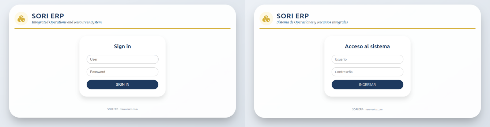

<!--
SORI documentation
FILE: sori/README.md
-->

# [SORI](https://github.com/maravento)

[](https://github.com/maravento)

<table width="100%">
  <tr>
    <td style="width: 50%; vertical-align: top;">
      <b>SORI</b> (Integrated Operations and Resources System) is a web system for invoicing, inventory, accounting and payroll. It serves several clients from one installation. Each client has its own login and its own database, so data is never mixed. It can load a client from a legacy Access database, to move over without disruption.
    </td>
    <td style="width: 50%; vertical-align: top;">
      <b>SORI</b> (Sistema de Operaciones y Recursos Integrales) es un sistema web de facturación, inventario, contabilidad y nómina. Atiende a varios clientes desde una sola instalación. Cada cliente tiene su propio acceso y su propia base de datos, por lo que los datos nunca se mezclan. Puede cargar un cliente desde una base Access anterior, para migrar sin traumatismos.
    </td>
  </tr>
</table>

[](https://www.maravento.com)

<!-- markdownlint-disable MD033 -->

## REQUIREMENTS

---

### Compatibility

<table width="100%">
  <tr>
    <td style="width: 50%; vertical-align: top;">
      Only tested on Ubuntu 24.04/26.04 LTS. Other versions or distributions are not tested and are used at your own risk.
    </td>
    <td style="width: 50%; vertical-align: top;">
      Solo probado en Ubuntu 24.04/26.04 LTS. Otras versiones o distribuciones no están probadas y se usan bajo tu responsabilidad.
    </td>
  </tr>
</table>

### Network

<table width="100%">
  <tr>
    <td style="width: 50%; vertical-align: top;">
      Internet access is required to install packages, and the browser requests the Font Awesome icon stylesheet from <code>cdnjs.cloudflare.com</code>. The frontend listens on <code>127.0.0.1:10600</code>, so it is not reachable from the LAN unless you change it.
    </td>
    <td style="width: 50%; vertical-align: top;">
      Se necesita Internet para instalar paquetes, y el navegador solicita la hoja de iconos de Font Awesome a <code>cdnjs.cloudflare.com</code>. El frontend escucha en <code>127.0.0.1:10600</code>, por lo que no es accesible desde la LAN salvo que lo cambies.
    </td>
  </tr>
</table>

### Software

| Component | Description | Descripción |
|---|---|---|
| Apache 2.4 | Web server with PHP as a module. | Servidor web con PHP como módulo. |
| PHP 8.3 | With the database extension and command line. | Con la extensión de base de datos y la línea de comandos. |
| MariaDB 10.11 | One control database and one database per client. | Una base de control y una base por cliente. |
| mdbtools | Reads the legacy Access databases. | Lee las bases Access anteriores. |

> The installer adds the missing packages. Packages that are already installed are reused.
>
> El instalador agrega los paquetes que falten. Los paquetes ya instalados se reutilizan.

## REPOSITORY STRUCTURE

---

```text
sori/
├── sorisetup.sh                    # installer, updater and uninstaller
├── db/
│   ├── schema.sql                  # structure of the client database (no data)
│   └── app.sql                     # control tables: clients, users, login attempts
├── tools/
│   ├── sorimigrate.php             # loads a client from an Access database (.mdb)
│   ├── soribk.sh                   # backup of the databases and the configuration
│   └── sorienv.sh                  # reader of sori.env for the backup
├── img/
│   └── sori.png                    # sign-in page in Spanish and English
└── web/
    ├── app/                        # code, kept outside the web root
    │   ├── lib.php                 # configuration, sessions and login
    │   ├── i18n.php                # language of the browser: Spanish or English
    │   ├── lang_en.php             # English text of the interface
    │   ├── modules.php             # list of modules and their area
    │   ├── vistas.php              # what each module lists, searches and opens
    │   └── views/                  # pages
    └── public/                     # web root
        ├── index.php               # single entry point
        └── assets/                 # stylesheet and script
```

### Additional Installed Paths

```text
etc/
├── apache2/
│   ├── sites-available/
│   │   └── sori.conf               # site on 127.0.0.1:10600 [0644 root:root]
│   └── sites-enabled/
│       └── sori.conf               # link to ../sites-available/sori.conf
└── sori/                           # configuration directory [0750 root:www-data]
    └── sori.env                    # generated configuration [0640 root:www-data]

var/
└── www/
    └── sori/                       # installed code [0755 root:root]
        ├── app/
        ├── db/
        ├── public/
        └── tools/
```

## HOW TO USE

---

| Command | Description | Descripción |
|---|---|---|
| `sudo bash sorisetup.sh` | Show the menu. | Muestra el menú. |
| `sudo bash sorisetup.sh --install` | Install SORI. | Instala SORI. |
| `sudo bash sorisetup.sh --update` | Install the missing packages and replace the code. Settings and client data are kept. | Instala los paquetes que falten y reemplaza el código. La configuración y los datos de los clientes se conservan. |
| `sudo bash sorisetup.sh --uninstall` | Remove SORI. | Desinstala SORI. |
| `sudo php /var/www/sori/tools/sorimigrate.php --client CODE --name "NAME" --mdb FILE.mdb` | Create a client and copy all its data from a legacy Access database, as it is. | Crea un cliente y copia todos sus datos desde una base Access anterior, tal cual. |
| `sudo php /var/www/sori/tools/sorimigrate.php --client CODE --name "NAME" --mdb FILE.mdb --anonymize` | For demonstrations only: replace third-party identity and contact data, and skip the legacy logins, audit log and report tables. | Solo para demostraciones: reemplaza los datos de identidad y contacto de terceros, y omite los accesos anteriores, el registro de auditoría y las tablas de informes. |
| `sudo php /var/www/sori/tools/sorimigrate.php --client CODE --name "NAME" --mdb FILE.mdb --replace` | Delete the client database first and load it again. | Borra primero la base del cliente y la carga de nuevo. |
| `sudo bash /var/www/sori/tools/soribk.sh` | Back up the databases and the configuration now. | Respalda ahora las bases de datos y la configuración. |
| `sudo apt-get remove --auto-remove mdbtools` | Remove the Access reader after the migrations are done. | Retira el lector de Access cuando terminen las migraciones. |

> The installer prints one line for each fact, with the same text in `sorisetup.log` next to the script. The password of the platform user `admin` is shown once.
> Each migrated client gets its own user, named like the client code, and its password is also shown once.
> Open `http://127.0.0.1:10600` and sign in.
>
> El instalador muestra una línea por cada hecho, con el mismo texto en `sorisetup.log`, junto al script. La contraseña del usuario de plataforma `admin` se muestra una sola vez.
> Cada cliente migrado recibe su propio usuario, con el nombre del código del cliente, y su contraseña también se muestra una sola vez.
> Abre `http://127.0.0.1:10600` e inicia sesión.

> **⚠️ WARNING -- Migration data:** `--anonymize` replaces identification numbers, names, addresses, phones and emails of third parties, and blanks the keys, tokens and licenses of the company. Free-text fields such as invoice notes are not scrubbed. Without `--anonymize`, the data is copied as it is, including real identification numbers.
>
> **⚠️ WARNING -- Datos de migración:** `--anonymize` reemplaza números de identificación, nombres, direcciones, teléfonos y correos de terceros, y deja en blanco las claves, tokens y licencias de la empresa. Los campos de texto libre, como las notas de factura, no se depuran. Sin `--anonymize`, los datos se copian tal cual, incluidos los números de identificación reales.

## SCOPE

---

| SCOPE | ALCANCE |
|---|---|
| <ul><li>Several clients in one installation, each with its own login and its own database.</li><li>A home page with one tab per area: Catalogs, Sales, Warehouse, Treasury, Accounting, Staff and Services. The interface is in Spanish when the browser prefers Spanish and in English for any other language.</li><li>The 17 modules with a screen list and search their records, and 16 of them open each record with its related rows, such as an invoice with its items. The data is read only.</li><li>The other 12 modules open an under-construction page with their record count.</li><li>Loading one company from a legacy Access database, with optional anonymization.</li><li>A platform user that lists the clients without seeing their data.</li></ul> | <ul><li>Varios clientes en una instalación, cada uno con su acceso y su base de datos.</li><li>Una página de inicio con una pestaña por área: Catálogos, Ventas, Almacén, Tesorería, Contabilidad, Personal y Servicios. La interfaz está en español si el navegador prefiere español y en inglés para cualquier otro idioma.</li><li>Los 17 módulos con pantalla listan y buscan sus registros, y 16 de ellos abren cada registro con sus filas relacionadas, como una factura con sus ítems. Los datos son de solo lectura.</li><li>Los otros 12 módulos abren una página en construcción con su cantidad de registros.</li><li>Carga de una empresa desde una base Access anterior, con anonimización opcional.</li><li>Un usuario de plataforma que lista los clientes sin ver sus datos.</li></ul> |
| **OUT OF SCOPE** | **FUERA DE ALCANCE** |
| <ul><li>Creating, editing and deleting records, issuing invoices, the electronic invoicing flow, accounting entries and payroll settlement: not implemented yet.</li><li>Screens to create or edit clients and users: they are created by the installer and the migration tool.</li><li>Password recovery.</li><li>HTTPS: the tunnel provides it.</li><li>Signing in with the legacy users: they are copied as data only.</li><li>The saved queries of the legacy database, which feed its reports: they are not migrated yet.</li><li>Dates and amounts are kept as text, as in the legacy database.</li></ul> | <ul><li>Crear, editar y eliminar registros, emitir facturas, el flujo de facturación electrónica, asientos contables y liquidación de nómina: aún no implementados.</li><li>Pantallas para crear o editar clientes y usuarios: los crean el instalador y la herramienta de migración.</li><li>Recuperación de contraseñas.</li><li>HTTPS: lo aporta el túnel.</li><li>Iniciar sesión con los usuarios anteriores: se copian solo como datos.</li><li>Las consultas guardadas de la base anterior, que alimentan sus informes: aún no se migran.</li><li>Las fechas y los importes se conservan como texto, igual que en la base anterior.</li></ul> |

## HOW IT WORKS

---

### Clients and data separation

<table width="100%">
  <tr>
    <td style="width: 50%; vertical-align: top;">
      <ul><li>The control database <code>sori</code> holds the clients, their users and the failed login attempts.</li><li>Each client has its own database, named <code>sori_</code> followed by the client code. It has the same structure as the legacy database.</li><li>At login, the user is tied to one client. From then on, every page reads only that client's database.</li><li>A deactivated client cannot sign in.</li><li>The platform user <code>admin</code> belongs to no client. It only sees the list of clients.</li><li>The application connects to the database with a user that can read and write data, not change structure.</li></ul>
    </td>
    <td style="width: 50%; vertical-align: top;">
      <ul><li>La base de control <code>sori</code> guarda los clientes, sus usuarios y los intentos de acceso fallidos.</li><li>Cada cliente tiene su propia base, llamada <code>sori_</code> seguido del código del cliente. Tiene la misma estructura que la base anterior.</li><li>Al iniciar sesión, el usuario queda ligado a un cliente. Desde ese momento, cada página lee solo la base de ese cliente.</li><li>Un cliente desactivado no puede iniciar sesión.</li><li>El usuario de plataforma <code>admin</code> no pertenece a ningún cliente. Solo ve la lista de clientes.</li><li>La aplicación se conecta a la base con un usuario que puede leer y escribir datos, no cambiar la estructura.</li></ul>
    </td>
  </tr>
</table>

### Login protection

<table width="100%">
  <tr>
    <td style="width: 50%; vertical-align: top;">
      <ul><li>Passwords are stored hashed, never in plain text.</li><li>After 5 failed attempts from the same address, sign-in is blocked for 10 minutes.</li><li>Forms carry a token that prevents requests sent from other sites.</li><li>A session expires after 2 hours without activity.</li><li>Behind the Cloudflare tunnel, the visitor address is taken from the tunnel header.</li><li>The limits are in <code>/etc/sori/sori.env</code>: <code>SESSION_TIMEOUT</code> (seconds, 7200), <code>LOGIN_MAX_ATTEMPTS</code> (5), <code>LOGIN_WINDOW_MINUTES</code> (10), <code>LOGIN_ATTEMPTS_KEEP_DAYS</code> (1) and <code>DETAIL_ROWS_LIMIT</code> (rows per child table, 500). The installer writes these defaults. The update never touches <code>sori.env</code>; a missing key uses its default.</li></ul>
    </td>
    <td style="width: 50%; vertical-align: top;">
      <ul><li>Las contraseñas se guardan cifradas, nunca en texto plano.</li><li>Tras 5 intentos fallidos desde la misma dirección, el acceso se bloquea 10 minutos.</li><li>Los formularios llevan un token que impide solicitudes enviadas desde otros sitios.</li><li>Una sesión caduca tras 2 horas sin actividad.</li><li>Detrás del túnel de Cloudflare, la dirección del visitante se toma del encabezado del túnel.</li><li>Los límites están en <code>/etc/sori/sori.env</code>: <code>SESSION_TIMEOUT</code> (segundos, 7200), <code>LOGIN_MAX_ATTEMPTS</code> (5), <code>LOGIN_WINDOW_MINUTES</code> (10), <code>LOGIN_ATTEMPTS_KEEP_DAYS</code> (1) y <code>DETAIL_ROWS_LIMIT</code> (filas por tabla hija, 500). El instalador escribe estos valores por defecto. La actualización nunca toca <code>sori.env</code>; una clave ausente usa su valor por defecto.</li></ul>
    </td>
  </tr>
</table>

### Modules

| Area | Description | Descripción |
|---|---|---|
| Catalogs | Third parties, Products | Terceros, Productos |
| Sales | Invoices, Resolutions, Quotations, Orders, Tables, Vouchers | Facturas, Resoluciones, Cotizaciones, Pedidos, Mesas, Bonos |
| Warehouse | Purchases, Inventory, Transfers, Requests | Compras, Inventario, Traslados, Solicitudes |
| Treasury | Receivables, Payables, Collections, Loans, Reconciliation | Cobros, Pagos, Recaudo, Créditos, Conciliación |
| Accounting | Accounting, IFRS, Exogenous, Depreciation, Budget, Due dates | Contabilidad, NIIF, Exógena, Depreciación, Presupuesto, Vencimientos |
| Staff | Payroll, Schedules | Nómina, Horarios |
| Services | Workshop, Maintenance, Hotel, Certificates | Taller, Mantenimiento, Hotel, Certificados |

### Migration

<table width="100%">
  <tr>
    <td style="width: 50%; vertical-align: top;">
      <ul><li>Migration is offered only for clients that have an Access database (<code>.mdb</code>). No other source is supported.</li><li>Command: <code>sudo php /var/www/sori/tools/sorimigrate.php --client CODE --name "NAME" --mdb FILE.mdb</code></li><li>It creates the client database with the full legacy structure, 305 tables, and loads the rows of the chosen company. Rows of other companies in the same file are skipped. Use <code>--empresa</code> to pick the company; the default is 1.</li><li>Every table is copied as it is, including the legacy users, the audit log and the report work tables. Nothing is left out.</li><li>With <code>--anonymize</code>, every identification number is replaced by a new one. The same number is used in every table, so invoices still match their third parties. The legacy users, the audit log and the report tables are skipped.</li><li>If a row, a column or a table cannot be loaded, it is reported and the exit status is not zero.</li><li>It prints the rows loaded per table.</li><li>If the client database already exists, the tool stops. <code>--replace</code> deletes it first.</li><li>It creates the client user and shows its password once.</li></ul>
    </td>
    <td style="width: 50%; vertical-align: top;">
      <ul><li>La migración se ofrece solo para clientes que tengan una base Access (<code>.mdb</code>). No se admite ningún otro origen.</li><li>Comando: <code>sudo php /var/www/sori/tools/sorimigrate.php --client CODE --name "NAME" --mdb FILE.mdb</code></li><li>Crea la base del cliente con toda la estructura anterior, 305 tablas, y carga las filas de la empresa elegida. Las filas de otras empresas del mismo archivo se omiten. Usa <code>--empresa</code> para elegir la empresa; por defecto es 1.</li><li>Cada tabla se copia tal cual, incluidos los usuarios anteriores, el registro de auditoría y las tablas de trabajo de informes. No se omite nada.</li><li>Con <code>--anonymize</code>, cada número de identificación se reemplaza por uno nuevo. Se usa el mismo número en todas las tablas, así que las facturas siguen coincidiendo con sus terceros. Se omiten los usuarios anteriores, el registro de auditoría y las tablas de informes.</li><li>Si una fila, una columna o una tabla no se puede cargar, se informa y el código de salida no es cero.</li><li>Muestra las filas cargadas por tabla.</li><li>Si la base del cliente ya existe, la herramienta se detiene. <code>--replace</code> la borra primero.</li><li>Crea el usuario del cliente y muestra su contraseña una sola vez.</li></ul>
    </td>
  </tr>
</table>

### Backup

<table width="100%">
  <tr>
    <td style="width: 50%; vertical-align: top;">
      <ul><li>The backup saves a dump of the control database and of every client database, the folder <code>/etc/sori</code>, the Apache site and the installed code, in one zip file.</li><li>The copies go to <code>/etc/bak/sori</code>. The three most recent are kept.</li><li>A monthly cron entry, <code>/etc/cron.d/sori</code>, runs it. The update runs it before it replaces the code and stops if it fails. The uninstall removes the cron entry and keeps the copies.</li><li>The key <code>BACKUP_DIR=/etc/bak/sori</code> in <code>sori.env</code> is required. Without it the backup refuses to run. The installer writes it; the update never touches <code>sori.env</code>, so on an existing installation add the key yourself.</li><li>To restore a database, unzip the copy and load its dump with <code>mariadb &lt; FILE.sql</code>.</li></ul>
    </td>
    <td style="width: 50%; vertical-align: top;">
      <ul><li>El respaldo guarda un volcado de la base de control y de cada base de cliente, la carpeta <code>/etc/sori</code>, el sitio de Apache y el código instalado, en un solo archivo zip.</li><li>Las copias van a <code>/etc/bak/sori</code>. Se conservan las tres más recientes.</li><li>Una entrada mensual de cron, <code>/etc/cron.d/sori</code>, lo ejecuta. La actualización lo ejecuta antes de reemplazar el código y se detiene si falla. La desinstalación quita la entrada de cron y conserva las copias.</li><li>La clave <code>BACKUP_DIR=/etc/bak/sori</code> en <code>sori.env</code> es obligatoria. Sin ella el respaldo no se ejecuta. El instalador la escribe; la actualización nunca toca <code>sori.env</code>, así que en una instalación existente agrega la clave tú.</li><li>Para restaurar una base, descomprime la copia y carga su volcado con <code>mariadb &lt; ARCHIVO.sql</code>.</li></ul>
    </td>
  </tr>
</table>

### Installation

<table width="100%">
  <tr>
    <td style="width: 50%; vertical-align: top;">
      <ul><li>It asks nothing. It installs the missing packages: <code>apache2</code>, <code>libapache2-mod-php</code>, <code>php-cli</code>, <code>php-mysql</code>, <code>mariadb-server</code>, <code>mariadb-client</code>, <code>mdbtools</code>, <code>curl</code>, <code>zip</code> and <code>cron</code>.</li><li>It creates <code>/var/www/sori</code> for the code and <code>/etc/sori</code> for the configuration.</li><li>It adds the Apache site <code>sori.conf</code>, listening only on <code>127.0.0.1:10600</code>. The existing Apache and MariaDB settings are kept, and Apache is reloaded.</li><li>It creates the database <code>sori</code> and the database user <code>sori</code>, which can read and write data but not change the structure.</li><li>It creates the platform user <code>admin</code>.</li><li>It stops if the port is taken or if SORI is already installed.</li></ul>
    </td>
    <td style="width: 50%; vertical-align: top;">
      <ul><li>No pregunta nada. Instala los paquetes que falten: <code>apache2</code>, <code>libapache2-mod-php</code>, <code>php-cli</code>, <code>php-mysql</code>, <code>mariadb-server</code>, <code>mariadb-client</code>, <code>mdbtools</code>, <code>curl</code>, <code>zip</code> y <code>cron</code>.</li><li>Crea <code>/var/www/sori</code> para el código y <code>/etc/sori</code> para la configuración.</li><li>Agrega el sitio de Apache <code>sori.conf</code>, que escucha solo en <code>127.0.0.1:10600</code>. Se conservan los ajustes existentes de Apache y MariaDB, y se recarga Apache.</li><li>Crea la base <code>sori</code> y el usuario de base de datos <code>sori</code>, que puede leer y escribir datos pero no cambiar la estructura.</li><li>Crea el usuario de plataforma <code>admin</code>.</li><li>Se detiene si el puerto está ocupado o si SORI ya está instalado.</li></ul>
    </td>
  </tr>
</table>

### Update and uninstall

<table width="100%">
  <tr>
    <td style="width: 50%; vertical-align: top;">
      <ul><li>The update installs the missing packages, replaces the code in <code>/var/www/sori</code> and reloads Apache. It keeps <code>sori.env</code> and all databases.</li><li>The uninstall removes <code>/var/www/sori</code>, <code>/etc/sori</code> and the Apache site, after you confirm. The answer is no by default.</li><li>The databases are deleted only if you confirm a second time. The answer is no by default.</li><li>The packages are never removed.</li></ul>
    </td>
    <td style="width: 50%; vertical-align: top;">
      <ul><li>La actualización instala los paquetes que falten, reemplaza el código en <code>/var/www/sori</code> y recarga Apache. Conserva <code>sori.env</code> y todas las bases.</li><li>La desinstalación elimina <code>/var/www/sori</code>, <code>/etc/sori</code> y el sitio de Apache, tras tu confirmación. La respuesta por defecto es no.</li><li>Las bases solo se borran si confirmas por segunda vez. La respuesta por defecto es no.</li><li>Los paquetes nunca se eliminan.</li></ul>
    </td>
  </tr>
</table>

## ⚠️ WARNING: NETWORK ACCESS

---

<table width="100%">
  <tr>
    <td style="width: 50%; vertical-align: top;">
      This project is designed for use on a local network (LAN). It does not include the security hardening needed for direct exposure to the internet. If internet access is required, an on-demand tunnel is recommended instead of opening ports directly. This enables access when needed without leaving the server permanently exposed.
    </td>
    <td style="width: 50%; vertical-align: top;">
      Este proyecto está diseñado para usarse en una red local (LAN). No cuenta con las medidas de seguridad necesarias para exponerlo directamente a Internet. Si se requiere acceso desde Internet, se recomienda utilizar un túnel bajo demanda en lugar de abrir puertos directamente. Así, el acceso se habilita cuando hace falta y el servidor no queda expuesto permanentemente.
    </td>
  </tr>
</table>

**Optional tunnel:**
- [Cloudflare Tunnel with Zero Trust Recommended](https://raw.githubusercontent.com/maravento/vault/master/scripts/bash/cftunnel.sh)

## NOTICE

---

<table width="100%">
  <tr>
    <td style="width: 50%; vertical-align: top;">
      <strong>This repository</strong>
      <ul>
        <li>May include third-party components.</li>
        <li>Does not accept Pull Requests. Changes must be proposed via Issues.</li>
        <li>This project does not support backward compatibility. New versions may require configuration changes or reinstallation.</li>
      </ul>
    </td>
    <td style="width: 50%; vertical-align: top;">
      <strong>Este repositorio</strong>
      <ul>
        <li>Puede incluir componentes de terceros.</li>
        <li>No acepta Pull Requests. Los cambios deben proponerse mediante Issues.</li>
        <li>Este proyecto no soporta retrocompatibilidad. Las nuevas versiones pueden requerir cambios de configuración o una reinstalación.</li>
      </ul>
    </td>
  </tr>
</table>

## DISCLAIMER

---

THE SOFTWARE IS PROVIDED "AS IS", WITHOUT WARRANTY OF ANY KIND, EXPRESS OR IMPLIED, INCLUDING BUT NOT LIMITED TO THE WARRANTIES OF MERCHANTABILITY, FITNESS FOR A PARTICULAR PURPOSE AND NONINFRINGEMENT. IN NO EVENT SHALL THE AUTHORS OR COPYRIGHT HOLDERS BE LIABLE FOR ANY CLAIM, DAMAGES OR OTHER LIABILITY, WHETHER IN AN ACTION OF CONTRACT, TORT OR OTHERWISE, ARISING FROM, OUT OF OR IN CONNECTION WITH THE SOFTWARE OR THE USE OR OTHER DEALINGS IN THE SOFTWARE.
