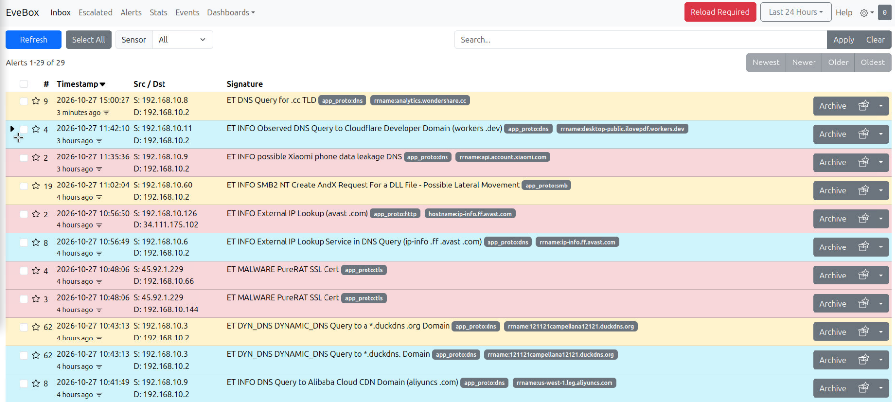

<!--
Suridata documentation
FILE: README.md
-->

# [Suridata](https://github.com/maravento)

[](https://github.com/maravento/vault)

<!-- markdownlint-disable MD033 -->

<table width="100%">
  <tr>
    <td style="width: 50%; vertical-align: top;">
      <p>Proxies and DNS filters only control traffic that passes through them, and connections such as BitTorrent DHT, TOR, Web3, blockchain and circumvention tools exist that bypass both controls. To cover these network blind spots, companies incorporate sophisticated intrusion detection and prevention systems (IDS/IPS); however, these require deep packet inspection, which can consume substantial resources that small and medium-sized networks lack.</p>
      <p>Suridata offers a different alternative to traditional IDS/IPS. It inspects a copy of the traffic in IDS mode and replaces IPS mode with iptables/ipset-based blocking rules, using the alerts generated by Suricata, which the administrator reviews in the Evebox viewer to choose which to include in blocking or exclusion.</p>
    </td>
    <td style="width: 50%; vertical-align: top;">
      <p>Los proxies y filtros DNS solo controlan el tráfico que pasa por ellos y existen conexiones como BitTorrent DHT, TOR, Web3, blockchain y herramientas de evasión (circumvention), que evitan ambos controles. Las empresas, para cubrir estos puntos ciegos en la red, incorporan sofisticados sistemas de detección y prevención de intrusiones (IDS/IPS); sin embargo, estos requieren de inspección profunda de paquetes, que puede consumir muchos recursos de los cuales carecen las redes pequeñas y medianas.</p>
      <p>Suridata ofrece una alternativa diferente al tradicional IDS/IPS. Inspecciona en modo IDS sobre una copia del tráfico y reemplaza el modo IPS por reglas de bloqueo basadas en iptables/ipset, a partir de las alertas que Suricata genera y que el administrador consulta en el visor Evebox, para elegir cuáles incorpora al bloqueo o a la exclusión.</p>
    </td>
  </tr>
</table>

## SCOPE

---

| SCOPE | ALCANCE |
|---|---|
| <ul> <li>Audit the computer's connections using one active IPv4 interface. Assign that interface to both network roles automatically.</li> <li>Inspect traffic on the selected LAN interface with a distinct WAN interface. Select both roles when several active IPv4 interfaces are available.</li> <li>Use the selected interface's actual IPv4 prefix and exclude configured LAN/WAN networks.</li> <li>Run Suricata as an IDS and use EveBox to inspect and analyze its alerts. Both components are required.</li> <li>The administrator maintains the selections in <code>drop.conf</code> and <code>disable.conf</code>; scheduled updates apply them.</li> <li>Build an external IPv4 destination list from selected alerts and apply it through ipset/iptables on the LAN packet path.</li> <li>Schedules rule updates, blocklist processing, monthly history cleanup and configuration backups; rotates the project log.</li> <li>Preserves configuration and processing state through <code>suribk.sh</code>, keeping up to three backup archives.</li> </ul> | <ul> <li>Audita las conexiones del computador con una interfaz IPv4 activa. Asigna automáticamente esa interfaz a ambos roles de red.</li> <li>Inspecciona el tráfico en la interfaz LAN seleccionada con una WAN diferente. Selecciona ambos roles cuando existen varias interfaces IPv4 activas.</li> <li>Utiliza el prefijo IPv4 real de la interfaz seleccionada y excluye las redes LAN/WAN configuradas.</li> <li>Ejecuta Suricata como IDS y utiliza EveBox para consultar y analizar sus alertas. Ambos componentes son obligatorios.</li> <li>El administrador mantiene las selecciones de <code>drop.conf</code> y <code>disable.conf</code>; las actualizaciones programadas las aplican.</li> <li>Genera una lista de destinos IPv4 externos a partir de alertas seleccionadas y la aplica mediante ipset/iptables sobre el tráfico recibido en LAN.</li> <li>Programa actualizaciones de reglas, procesamiento de bloqueos, limpieza mensual del historial y respaldos de configuración; rota el log del proyecto.</li> <li>Respalda configuración y estado de procesamiento mediante <code>suribk.sh</code>, conservando hasta tres archivos de respaldo.</li> </ul> |
| **OUT OF SCOPE** | **FUERA DE ALCANCE** |
| <ul> <li>IPv6 processing, exclusions and blocking are not supported by Suridata; its address handling is IPv4-only.</li> <li>Suricata operates only as an IDS; Suridata does not configure inline packet prevention. Firewall blocking is a separate, asynchronous mechanism.</li> <li>Suridata does not analyze alerts to edit <code>drop.conf</code> or <code>disable.conf</code> automatically. Selecting or adjusting that policy is manual.</li> <li>Auditing local connections does not add OUTPUT rules to block traffic originating on the computer. Existing PREROUTING rules do not provide that coverage.</li> <li>Suridata does not assign interface addresses, configure gateways or set up NAT. The required IPv4 configuration must already exist.</li> <li>The installer configures one inspected LAN interface, not several LAN capture interfaces simultaneously. These are Suridata limits, not limits of the Suricata engine.</li> <li>Suridata does not configure switch traffic mirroring. Traffic not delivered to the selected capture interface is outside its inspection coverage.</li> <li>Configuration backups exclude Suricata event logs and the EveBox event database; they do not preserve the alert history.</li> </ul> | <ul> <li>Suridata no admite procesamiento, exclusiones ni bloqueos IPv6; su manejo de direcciones es exclusivamente IPv4.</li> <li>Suricata opera únicamente como IDS; Suridata no configura prevención de paquetes en línea. El bloqueo del firewall es un mecanismo separado y asíncrono.</li> <li>Suridata no analiza alertas para editar automáticamente <code>drop.conf</code> o <code>disable.conf</code>. La selección y ajuste de esa política son manuales.</li> <li>Auditar conexiones locales no agrega reglas OUTPUT para bloquear tráfico originado en el computador. Las reglas existentes en PREROUTING no proporcionan esa cobertura.</li> <li>Suridata no asigna direcciones a interfaces, configura puertas de enlace ni establece NAT. La configuración IPv4 requerida debe existir previamente.</li> <li>El instalador configura una interfaz LAN de inspección, no varias interfaces LAN de captura simultáneas. Son límites de Suridata, no del motor Suricata.</li> <li>Suridata no configura el mirroring de tráfico en switches. El tráfico que no llega a la interfaz de captura seleccionada queda fuera de su cobertura de inspección.</li> <li>Los respaldos de configuración excluyen los registros de eventos de Suricata y la base de eventos de EveBox; no conservan el historial de alertas.</li> </ul> |

## REQUIREMENTS

---

<table width="100%">
  <tr>
    <td style="width: 50%; vertical-align: top;">
      <p>Only tested on Ubuntu 24.04/26.04 LTS. Other versions or distributions are not tested and are used at your own risk.</p>
    </td>
    <td style="width: 50%; vertical-align: top;">
      <p>Solo probado en Ubuntu 24.04/26.04 LTS. Otras versiones o distribuciones no están probadas y se usan bajo tu responsabilidad.</p>
    </td>
  </tr>
</table>

| Component | Description | Descripción |
|---|---|---|
| System | Ubuntu with Bash, APT, systemd, and root privileges. | Ubuntu con Bash, APT, systemd y permisos root. |
| Network | At least one UP interface with configured global IPv4. With one eligible interface, use it automatically for inspection and both network roles. With several, select distinct WAN and LAN interfaces. Validate their IPv4 and prefixes before package installation. | Al menos una interfaz UP con IPv4 global configurada. Con una sola interfaz válida, úsala automáticamente para inspección y ambos roles de red. Con varias, selecciona interfaces WAN y LAN diferentes. Valida sus IPv4 y prefijos antes de instalar paquetes. |
| Internet | Required for package installation, EveBox repository access, and rule downloads. | Necesario para instalar paquetes, acceder al repositorio EveBox y descargar reglas. |
| Packages | The installer installs missing Suricata, suricata-update, jq, ipset, iptables, ulogd2, Python 3, curl, ca-certificates, zip, logrotate, cron, iproute2, grep, coreutils, findutils, util-linux, sed, and libc-bin packages. | El instalador agrega los paquetes faltantes Suricata, suricata-update, jq, ipset, iptables, ulogd2, Python 3, curl, ca-certificates, zip, logrotate, cron, iproute2, grep, coreutils, findutils, util-linux, sed y libc-bin. |
| EveBox | Required component, installed from its external repository; installation or service failures abort setup. | Componente obligatorio, instalado desde su repositorio externo; los fallos de instalación o servicio abortan el instalador. |
| Fresh installation | Existing Suricata, EveBox, or Suridata configuration prevents fresh installation. Installed Snort also prevents installation. | Suricata, EveBox o configuración Suridata existentes impiden una instalación nueva. Snort instalado también impide instalar. |

## REPOSITORY STRUCTURE

---

```text
suridata/                      # Repository root
├── README.md                  # Project documentation
├── surisetup.sh               # Installer: install, update, uninstall, status
├── data/                      # Initial data deployed to /etc/suricata/data/
│   ├── disable.conf             # Rule selections suppressed by suricata-update
│   ├── drop.conf                # Rule selections converted to the drop action
│   └── suridata.txt             # Persistent IPv4 blocklist template
└── install/                   # Scripts deployed to /etc/suricata/; EveBox files below
    ├── evebox.service           # Unit deployed to /etc/systemd/system/evebox.service
    ├── evebox.yaml              # Settings deployed to /etc/evebox/evebox.yaml
    ├── suridataenv.sh           # Shared configuration reader
    ├── suribk.sh                # Configuration backup and archive retention
    ├── suricataclean.sh         # Suricata log and EveBox event cleanup
    ├── suricataupdate.sh        # Rule updates and service restarts
    └── suridata.sh              # Alert processing and destination blocking
```

## HOW TO USE

---

### Installer

```bash
git clone --depth=1 https://github.com/maravento/vault.git
cd vault/suridata

# or

wget -qO gitfolder.py https://raw.githubusercontent.com/maravento/vault/master/scripts/python/gitfolder.py
chmod +x gitfolder.py
python3 gitfolder.py https://github.com/maravento/vault/suridata
cd suridata

# Install
sudo bash surisetup.sh --install

# Update
sudo bash surisetup.sh --update

# Uninstall
sudo bash surisetup.sh --uninstall

# Status
sudo bash surisetup.sh --status

# Interactive menu
sudo bash surisetup.sh

# Help
sudo bash surisetup.sh --help   # or -h
```

| Command | Description | Descripción |
|---|---|---|
| `sudo bash surisetup.sh --install` | Install using one IPv4 interface automatically, or select WAN/LAN when several are eligible. | Instala usando automáticamente una interfaz IPv4 o selecciona WAN/LAN cuando existen varias válidas. |
| `sudo bash surisetup.sh --update` | Back up and refresh the installed project. | Respalda y actualiza el proyecto instalado. |
| `sudo bash surisetup.sh --uninstall` | Remove the project after confirmation. | Elimina el proyecto después de confirmar. |
| `sudo bash surisetup.sh --status` | Inspect configuration, services, backups, blocklist, and firewall state. | Consulta configuración, servicios, respaldos, lista y estado del cortafuegos. |
| `sudo bash surisetup.sh` | Open the menu; Enter selects Exit. | Abre el menú; Enter selecciona Exit. |
| `sudo bash surisetup.sh --help` | Display accepted actions. | Muestra las acciones aceptadas. |

### Unattended installation

<table width="100%">
  <tr>
    <td style="width: 50%; vertical-align: top;">Replace the example interfaces before running. The LAN network and mask come from its configured IPv4/prefix. Use <code>SURIDATA_SERVER_IP</code> to select an existing address when LAN has several.</td>
    <td style="width: 50%; vertical-align: top;">Sustituye las interfaces del ejemplo. La red y máscara LAN proceden de su IPv4/prefijo configurados. Utiliza <code>SURIDATA_SERVER_IP</code> para elegir una dirección existente cuando LAN tenga varias.</td>
  </tr>
</table>

```bash
sudo env SURIDATA_WAN_IFACE=enp1s0 SURIDATA_LAN_IFACE=enp2s0 \
  SURIDATA_SERVER_IP=192.168.0.1 bash surisetup.sh --install
```

### Operational commands

| Command | Description | Descripción |
|---|---|---|
| `sudo bash /etc/suricata/suridata.sh` | Process alerts and refresh firewall blocks. | Procesa alertas y actualiza bloqueos. |
| `sudo bash /etc/suricata/suricataupdate.sh` | Stop Suricata and EveBox, update selected rules, then start both services. | Detiene Suricata y EveBox, actualiza las reglas seleccionadas e inicia ambos servicios. |
| `sudo bash /etc/suricata/suribk.sh` | Create a configuration backup. | Crea un respaldo de configuración. |
| `sudo bash /etc/suricata/suribk.sh --install` | Register the monthly backup task. | Registra el respaldo mensual. |
| `sudo bash /etc/suricata/suribk.sh --uninstall` | Remove the backup task; keep archives. | Elimina la tarea de respaldo; conserva los archivos. |
| `sudo bash /etc/suricata/suricataclean.sh` | Clear Suricata logs and EveBox event history. | Borra registros Suricata e historial de eventos EveBox. |

> **⚠️ WARNING -- History cleanup:** The installer schedules monthly cleanup in `/etc/cron.d/suridata`. Cleanup clears Suricata event logs and deletes compressed logs, EveBox event databases, and bookmarks. Manual execution performs the same cleanup. `suribk.sh` does not back up these logs or event databases. Export any history you need before the scheduled or manual cleanup.
>
> **⚠️ WARNING -- Limpieza del historial:** El instalador programa una limpieza mensual en `/etc/cron.d/suridata`. La limpieza vacía registros de eventos Suricata. Elimina registros comprimidos, bases de eventos EveBox y marcadores. La ejecución manual realiza la misma limpieza. `suribk.sh` no respalda estos registros ni las bases de eventos. Exporta el historial necesario antes de la limpieza mensual o manual.

## HOW IT WORKS

---

### Update checks

| Step | Description | Descripción |
|---|---|---|
| Before copying | The installer checks all required source files and destinations, write access, available space, immutable attributes and relevant locks. | El instalador comprueba todos los orígenes y destinos, escritura, espacio disponible, atributos inmutables y bloqueos relevantes. |
| Backup | The installer invokes `suribk.sh`. If `suribk.sh` fails, the installer aborts before pausing consumers or replacing files, without writing `done`. | El instalador invoca `suribk.sh`. Si `suribk.sh` falla, el instalador aborta antes de pausar procesos o reemplazar archivos, sin escribir `done`. |
| Pause | The installer pauses its cron file and stops affected services and daemons. It verifies they have stopped and waits for running jobs before replacing files. If a pause fails before any replacement, the installer attempts to resume the previous consumers and schedule. | El instalador pausa su archivo cron y detiene los servicios y demonios afectados. Comprueba su detención y espera que terminen las tareas en ejecución antes de reemplazar archivos. Si falla una pausa antes de reemplazar archivos, el instalador intenta reanudar los procesos y la programación anteriores. |
| Copy | The installer repeats the checks immediately before copying. It verifies every replacement and its file contents. If a replacement fails, it aborts without `done`; it does not resume the consumers or restore the backup. The paused schedule remains at `/etc/cron.d/suridata.update-disabled`. | El instalador repite las comprobaciones inmediatamente antes de copiar. Comprueba cada reemplazo y el contenido copiado. Si falla un reemplazo, aborta sin `done`; no reanuda los procesos ni restaura el respaldo. La programación pausada permanece en `/etc/cron.d/suridata.update-disabled`. |
| Finish | The installer regenerates its complete cron file and resumes the consumers that were active. It writes `done` only after successful completion. | El instalador regenera su archivo cron completo y reanuda los procesos que estaban activos. Escribe `done` únicamente si termina correctamente. |


### Installation and updates

| Action | Description | Descripción |
|---|---|---|
| Install | Validate LAN and WAN IPv4 before installing packages. Generate `suridata.env`, deploy scripts, configure Suricata for IDS operation, install EveBox, and register cron and log rotation. Require both components and their services; abort on failure without a successful completion message. Run the initial rule update and blocklist refresh. | Valida IPv4 LAN y WAN antes de instalar paquetes. Genera `suridata.env`, despliega scripts y configura Suricata como IDS. Instala EveBox, cron y rotación. Exige ambos componentes y sus servicios; aborta ante fallos sin registrar un cierre exitoso. Ejecuta la actualización inicial de reglas y lista. |
| Update | Require a successful backup. Replace scripts, EveBox configuration/unit, cron, and logrotate settings. Preserve existing `suridata.env`, `drop.conf`, `disable.conf`, and `suridata.txt`. Create missing data files. | Exige un respaldo correcto. Reemplaza scripts, configuración/unidad EveBox, cron y rotación. Conserva `suridata.env`, `drop.conf`, `disable.conf` y `suridata.txt` existentes. Crea datos ausentes. |
| Uninstall | Confirm removal. Require a successful backup; abort if the backup script is missing, not executable, or fails. Wait for processing, rule updates and cleanup to finish before removing project scripts, cron, rotation settings, state, and firewall entries. Ask separately about protected data, Suricata packages, and EveBox. | Confirma la eliminación. Exige un respaldo correcto; aborta si el script falta, no es ejecutable o falla. Espera a que terminen el procesamiento, la actualización de reglas y la limpieza antes de eliminar scripts, cron, rotación, estado y reglas. Pregunta separadamente por datos, paquetes Suricata y EveBox. |

### Configuration

<table width="100%">
  <tr>
    <td style="width: 50%; vertical-align: top;">
      When several interfaces are available, select the LAN interface from the list. Installation aborts with <code>ERROR: ... -abort</code> if the selected LAN has no configured IPv4 address. Select an address when several exist. The network and mask come from that address and its actual prefix. These installers do not configure network interfaces. Explicit interface/address values supplied by a parent installer reuse its selection.
    </td>
    <td style="width: 50%; vertical-align: top;">
      Si existen varias interfaces, selecciona LAN desde la lista. La instalación aborta con <code>ERROR: ... -abort</code> si LAN no tiene IPv4 configurada. Selecciona una dirección cuando existan varias. La red y máscara proceden de esa dirección y su prefijo real. Estos instaladores no configuran interfaces. Los valores explícitos enviados por otro instalador reutilizan su selección.
    </td>
  </tr>
</table>

#### suridata.env

<table width="100%">
  <tr>
    <td style="width: 50%; vertical-align: top;">Edit <code>/etc/suricata/data/suridata.env</code> using plain <code>KEY=value</code> lines, without surrounding quotes or spaces. Its owner is <code>root:root</code>, with mode <code>640</code>.</td>
    <td style="width: 50%; vertical-align: top;">Edita <code>/etc/suricata/data/suridata.env</code> con líneas <code>KEY=value</code>, sin comillas ni espacios externos. Su propietario es <code>root:root</code>, con permisos <code>640</code>.</td>
  </tr>
</table>

| Key | Description | Descripción |
|---|---|---|
| `WAN_IFACE` | WAN interface whose configured IPv4 networks are excluded; equals `INTERFACESv4` with one eligible interface. | Interfaz WAN cuyas redes IPv4 configuradas se excluyen; coincide con `INTERFACESv4` cuando existe una sola interfaz válida. |
| `INTERFACESv4` | Inspected interface; the selected LAN when WAN/LAN differ. | Interfaz inspeccionada; corresponde a LAN cuando WAN y LAN son diferentes. |
| `SERV_SUBNET` | LAN IPv4 network address derived from the selected interface address. | Dirección de red IPv4 LAN calculada desde la dirección seleccionada. |
| `SERV_MASK` | Actual LAN netmask; used together with `SERV_SUBNET` for exclusions. | Máscara real LAN; utilizada junto con `SERV_SUBNET` para las exclusiones. |
| `BACKUP_DIR` | Absolute backup directory; initially `/etc/bak/suridata`. | Directorio absoluto de respaldos; inicialmente `/etc/bak/suridata`. |

### Alert processing and blocking

| Stage | Description | Descripción |
|---|---|---|
| Rule selection | `disable.conf` suppresses selected rules. `drop.conf` converts selected signatures to the drop action through `suricata-update`. Both accept SID and `re:` selections. | `disable.conf` desactiva reglas seleccionadas. `drop.conf` convierte firmas a drop mediante `suricata-update`. Ambos aceptan SID y selecciones `re:`. |
| Detection | Suricata operates as an IDS using AF-PACKET. Drop-action signatures select alerts for subsequent blocklist processing; they do not make AF-PACKET an inline IPS. | Suricata funciona como IDS mediante AF-PACKET. Las firmas drop seleccionan alertas para procesar bloqueos posteriores. No convierten AF-PACKET en IPS en línea. |
| Event reading | Read `/var/log/suricata/eve.json` from the saved byte offset and track its device/inode identity. Start from zero when a recorded identity changes after rotation. Rescan existing events for newly selected drop SIDs. Requires one JSON event per line:<ul><li>Process only lines that end on a newline.</li><li>Keep the final fragment without a newline pending for the next run.</li><li>Skip damaged lines, count them and report them with a `WARNING`.</li><li>Save the position after the last processed line.</li><li>Keep the position unchanged when the read fails.</li></ul> | Lee `/var/log/suricata/eve.json` desde el desplazamiento guardado y registra su identidad mediante dispositivo e inode. Empieza desde cero cuando cambia una identidad registrada después de rotar el archivo. Revisa eventos anteriores para nuevos SID drop. Exige un evento JSON por línea:<ul><li>Procesa únicamente las líneas terminadas en salto de línea.</li><li>Conserva pendiente el fragmento final sin salto de línea.</li><li>Descarta las líneas dañadas, las cuenta y las informa con `WARNING`.</li><li>Guarda la posición después de la última línea procesada.</li><li>Conserva la posición cuando falla la lectura.</li></ul> |
| Address selection | Select the external endpoint when the other endpoint matches an excluded LAN/WAN prefix. Ignore flows with both endpoints local or both external. Accept IPv4 only. | Selecciona el extremo externo cuando el otro coincide con un prefijo LAN/WAN excluido. Ignora flujos completamente locales o externos. Acepta solamente IPv4. |
| Exclusions | Exclude the LAN network using `SERV_SUBNET`/`SERV_MASK` and the current WAN IPv4 networks. Remove matching addresses already listed. If WAN IPv4 detection fails, abort before changing the blocklist or ipset. Existing blocks remain unchanged. | Excluye la red LAN mediante `SERV_SUBNET`/`SERV_MASK` y las redes IPv4 WAN actuales. Retira direcciones coincidentes previamente listadas. Si falla detectar IPv4 WAN, aborta antes de modificar la lista o el ipset. Conserva los bloqueos existentes. |
| Persistent list | Append unique addresses to `/etc/suricata/data/suridata.txt`. There is no automatic expiration. Manual removal applies on the next refresh, but matching alerts may add addresses again. | Agrega direcciones únicas a `/etc/suricata/data/suridata.txt`. No existe vencimiento automático. La eliminación manual aplica al actualizar. Alertas coincidentes pueden agregar direcciones nuevamente. |
| Firewall | Populate a temporary ipset and swap it into `suridata`. Add destination `NFLOG` and `DROP` rules in `mangle/PREROUTING` on the LAN interface. Refresh existing blocks even without new matching SIDs. | Carga un ipset temporal e intercámbialo con `suridata`. Agrega reglas de destino `NFLOG` y `DROP` en `mangle/PREROUTING` sobre LAN. Actualiza bloqueos aunque no existan nuevos SID. |
| Personal use | A single interface supports IDS inspection and EveBox analysis of the computer's connections. Existing PREROUTING destination rules do not block locally generated outbound traffic; this mode does not add OUTPUT rules. | Una sola interfaz permite inspección IDS y análisis en EveBox de las conexiones del computador. Las reglas de destino existentes en PREROUTING no bloquean el tráfico saliente generado localmente; este modo no agrega reglas OUTPUT. |

> **⚠️ WARNING -- Blocking policy:** Review the supplied SID and category selections before deployment. False positives can block legitimate destinations.
>
> **⚠️ WARNING -- Política de bloqueo:** Revisa los SID y categorías antes del despliegue. Los falsos positivos pueden bloquear destinos legítimos.

### EveBox

[](https://www.maravento.com)

| Setting | Description | Descripción |
|---|---|---|
| Access | Open `http://localhost:5636` on the server. Listen on `127.0.0.1`, without TLS or authentication. | Abre `http://localhost:5636` en el servidor. Escucha en `127.0.0.1`, sin TLS ni autenticación. |
| Storage | SQLite event storage with seven-day configured retention. Read `eve.json` and `eve.*.json`. | Almacena eventos en SQLite con retención configurada de siete días. Lee `eve.json` y `eve.*.json`. |
| Service | Run as root under systemd with automatic restart. | Ejecuta como root mediante systemd con reinicio automático. |

### Scheduled tasks and logs

| Schedule / path | Description | Descripción |
|---|---|---|
| `/etc/cron.d/suridata` | Single project schedule file, owned by root with mode `644`. | Archivo único de tareas, propiedad root con permisos `644`. |
| Every five minutes | Run `suridata.sh`. | Ejecuta `suridata.sh`. |
| Daily at 02:00 | Run `suricataupdate.sh`: stop and verify both services, update rules, then start both services. | Ejecuta `suricataupdate.sh`: detiene y verifica ambos servicios, actualiza reglas e inicia ambos servicios. |
| Monthly | Run `suricataclean.sh` and `suribk.sh` as separate tasks. | Ejecuta `suricataclean.sh` y `suribk.sh` como tareas separadas. |
| `surisetup.log` | Installer log beside `surisetup.sh`; emptied on each invocation. | Registro junto a `surisetup.sh`; vaciado en cada ejecución. |
| `/var/log/suridata.log` | Shared operational log; daily rotation, seven retained rotations. | Registro operativo compartido; rotación diaria, siete archivos retenidos. |
| `/etc/logrotate.d/suridata` | Rotation settings for the operational log, owned by root with mode `644`. | Configuración de rotación del registro operativo, propiedad root con permisos `644`. |
| `/var/lib/suricata/suridata.offset` | Saved byte position and device/inode identity of `eve.json`. | Posición en bytes e identidad mediante dispositivo e inode de `eve.json`. |
| `/var/lib/suricata/suridata.sids` | Previously processed drop SID selection. | Selección de SID drop procesados anteriormente. |

### Backups and cleanup

| Operation | Description | Descripción |
|---|---|---|
| Backup | Create `suribk_YYYYMMDD_HHMMSS.zip` in `BACKUP_DIR`. Keep at most three archives. Store existing Suricata/EveBox settings, project cron and rotation settings, EveBox unit/repository list, offset, and SID state. Exclude downloaded rules under `/var/lib/suricata` and event history. | Crea `suribk_YYYYMMDD_HHMMSS.zip` en `BACKUP_DIR`. Conserva hasta tres archivos. Incluye configuración Suricata/EveBox, cron, rotación, unidad/repositorio EveBox, desplazamiento y estado SID. Excluye reglas descargadas e historial. |
| Backup directory | Use a dedicated directory. The backup script removes entries not matching `suribk_*.zip` before creating an archive. | Utiliza un directorio exclusivo. El script elimina entradas diferentes de `suribk_*.zip` antes de crear el respaldo. |
| Cleanup | Monthly cleanup limits the accumulation of logs and events. Disk usage depends on traffic and configuration. Networks with higher activity may exceed 100 GB per month. Acquire the maintenance and Suridata locks. Stop and verify Suricata and EveBox before clearing logs, compressed logs, and saved offset. Remove EveBox event databases and bookmarks. Keep EveBox configuration database and the persistent blocklist. Start both services after all cleanup. | La limpieza mensual limita la acumulación de registros y eventos. El espacio utilizado depende del tráfico y la configuración. En redes con mayor actividad, puede superar 100 GB mensuales. Adquiere los bloqueos de mantenimiento y Suridata. Detiene y verifica Suricata y EveBox antes de borrar registros, comprimidos y desplazamiento. Elimina bases de eventos y marcadores EveBox. Conserva configuración EveBox y lista persistente. Inicia ambos servicios después de completar la limpieza. |

## ⚠️ WARNING: NETWORK ACCESS

---

<table width="100%">
  <tr>
    <td style="width: 50%; vertical-align: top;">
      This project is designed for use on a local network (LAN). It does not include the security hardening needed for direct exposure to the internet. If internet access is required, an on-demand tunnel is recommended instead of opening ports directly. This enables access when needed without leaving the server permanently exposed.
    </td>
    <td style="width: 50%; vertical-align: top;">
      Este proyecto está diseñado para usarse en una red local (LAN). No cuenta con las medidas de seguridad necesarias para exponerlo directamente a Internet. Si se requiere acceso desde Internet, se recomienda utilizar un túnel bajo demanda en lugar de abrir puertos directamente. Así, el acceso se habilita cuando hace falta y el servidor no queda expuesto permanentemente.
    </td>
  </tr>
</table>

**Optional tunnel:**
- [Cloudflare Tunnel with Zero Trust Recommended](https://raw.githubusercontent.com/maravento/vault/master/scripts/bash/cftunnel.sh)

## NOTICE

---

<table width="100%">
  <tr>
    <td style="width: 50%; vertical-align: top;">
      <strong>This repository</strong>
      <ul>
        <li>May include third-party components.</li>
        <li>Does not accept Pull Requests. Changes must be proposed via Issues.</li>
        <li>This project does not support backward compatibility. New versions may require configuration changes or reinstallation.</li>
        <li>Adding custom tasks to the project's cron file is not recommended because each installation or update rewrites it.</li>
      </ul>
    </td>
    <td style="width: 50%; vertical-align: top;">
      <strong>Este repositorio</strong>
      <ul>
        <li>Puede incluir componentes de terceros.</li>
        <li>No acepta Pull Requests. Los cambios deben proponerse mediante Issues.</li>
        <li>Este proyecto no soporta retrocompatibilidad. Las nuevas versiones pueden requerir cambios de configuración o una reinstalación.</li>
        <li>No se recomienda programar tareas propias en el cron del proyecto, ya que se reescribe en cada instalación o actualización.</li>
      </ul>
    </td>
  </tr>
</table>

## DISCLAIMER

---

THE SOFTWARE IS PROVIDED "AS IS", WITHOUT WARRANTY OF ANY KIND, EXPRESS OR IMPLIED, INCLUDING BUT NOT LIMITED TO THE WARRANTIES OF MERCHANTABILITY, FITNESS FOR A PARTICULAR PURPOSE AND NONINFRINGEMENT. IN NO EVENT SHALL THE AUTHORS OR COPYRIGHT HOLDERS BE LIABLE FOR ANY CLAIM, DAMAGES OR OTHER LIABILITY, WHETHER IN AN ACTION OF CONTRACT, TORT OR OTHERWISE, ARISING FROM, OUT OF OR IN CONNECTION WITH THE SOFTWARE OR THE USE OR OTHER DEALINGS IN THE SOFTWARE.
