# [Uniweb](https://github.com/maravento)

[](https://github.com/maravento)

<!-- markdownlint-disable MD033 -->

<table width="100%">
  <tr>
    <td style="width: 50%; vertical-align: top;">
     <b>Uniweb</b> installs uniCenta oPOS Web Server, MySQL Server and HeidiSQL on Windows, ready to use from the browser. It includes <b>Trek</b>, a backup and rescue tool for MySQL databases.
    </td>
    <td style="width: 50%; vertical-align: top;">
     <b>Uniweb</b> instala uniCenta oPOS Web Server, MySQL Server y HeidiSQL en Windows, listos para usar desde el navegador. Incluye <b>Trek</b>, una herramienta de respaldo y rescate de bases de datos MySQL.
    </td>
  </tr>
</table>

## DATA SHEET

---

| File | OS | Size |
| :---: | :---: | :---: |
| [uniweb.exe (.zip)](https://mega.nz/file/qQdEnSJJ#sExJCzqSCqICulNJt0YOGMdxYss4d-tGYl78mtMi4MA) | Windows 10/11 x64 | 592,5 MB |

| Package | Version | Path |
| :---: | :---: | :---: |
| uniCenta oPOS Web Server | 4.5.4 | <code>C:\uniweb\uniCenta-WEBSERVER</code> |
| MySQL Server | 5.7.44 x64 | <code>C:\uniweb\mysql</code> |
| HeidiSQL Portable | 12.22 x64 | <code>C:\uniweb\HeidiSQL</code> |
| Java SE Runtime Environment | 8u513 x64 | System |
| Visual C++ Redistributable AIO | 0.107.0 | System |

## REQUIREMENTS

---

### Compatibility

<table width="100%">
  <tr>
    <td style="width: 50%; vertical-align: top;">
      Only tested on Windows 10/11 x64. Other versions are not tested and are used at your own risk.
    </td>
    <td style="width: 50%; vertical-align: top;">
      Solo probado en Windows 10/11 x64. Otras versiones no están probadas y se usan bajo tu responsabilidad.
    </td>
  </tr>
</table>

## HOW TO USE

---

<table width="100%">
  <tr>
    <td style="width: 50%; vertical-align: top;">
     Disable your Antivirus, Antimalware, SmartScreen or any other security solution, close all windows and check the date and time of your PC. Run the installer with double click, accept privileged execution and follow the instructions on the screen. The installer unpacks its files to <code>C:\uniwebtmp</code> and deletes that folder at the end.
    </td>
    <td style="width: 50%; vertical-align: top;">
     Desactive su Antivirus, Antimalware, SmartScreen o cualquier otra solución de seguridad, cierre todas las ventanas y verifique la fecha y hora de su PC. Ejecute el instalador con doble clic, acepte la ejecución con privilegios y siga las instrucciones en pantalla. El instalador descomprime sus archivos en <code>C:\uniwebtmp</code> y borra esa carpeta al terminar.
    </td>
  </tr>
</table>

> This is requested because this project uses batch scripts packaged into a .exe, and antivirus software may flag this as a false positive. If in doubt, you can unzip the .exe and audit the scripts, run the packages manually, or choose not to use this project.
>
> Esto se solicita porque este proyecto usa scripts batch empaquetados en un .exe, y los antivirus pueden detectarlo como falso positivo. Si tiene dudas, puede descomprimir el .exe y auditar los scripts, ejecutar los paquetes manualmente, o no usar este proyecto.

### SHORTCUT

<table width="100%">
  <tr>
    <td style="width: 50%; vertical-align: top;">
     uniweb is a portable system. By default, nothing starts with the PC: MySQL, uniCenta and HeidiSQL only start from the interactive menu of the <code>uniweb</code> shortcut on the desktop, with the options it offers. Options <b>3 Enable Autostart</b> and <b>4 Disable Autostart</b> turn automatic start on or off for both: MySQL at PC startup and uniCenta at user logon. uniCenta opens at <code>http://localhost:8080/unicentaopos/</code>.
    </td>
    <td style="width: 50%; vertical-align: top;">
     uniweb es un sistema portable. Por defecto, nada arranca al encender el PC: MySQL, uniCenta y HeidiSQL solo se inician desde el menú interactivo del acceso directo <code>uniweb</code> del escritorio, con las opciones que ofrece. Las opciones <b>3 Enable Autostart</b> y <b>4 Disable Autostart</b> activan o desactivan el inicio automático de los dos: MySQL al encender el PC y uniCenta al iniciar sesión. uniCenta abre en <code>http://localhost:8080/unicentaopos/</code>.
    </td>
  </tr>
</table>

[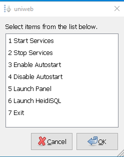](https://www.maravento.com)

| Option | Description | Descripción |
| --- | --- | --- |
| 1 Start Services | Starts MySQL Server, then uniCenta Web Server | Inicia MySQL Server y después uniCenta Web Server |
| 2 Stop Services | Stops uniCenta Web Server, then MySQL Server | Detiene uniCenta Web Server y después MySQL Server |
| 3 Enable Autostart | MySQL starts with the PC and uniCenta at user logon | MySQL arranca con el PC y uniCenta al iniciar sesión |
| 4 Disable Autostart | MySQL and uniCenta go back to manual start | MySQL y uniCenta vuelven a inicio manual |
| 5 Launch Panel | Opens <code>http://localhost:8080/unicentaopos/</code> in the browser | Abre <code>http://localhost:8080/unicentaopos/</code> en el navegador |
| 6 Launch HeidiSQL | Opens HeidiSQL to manage MySQL | Abre HeidiSQL para administrar MySQL |
| 7 Exit | Closes the menu. If services are still running, it warns and returns to the menu | Cierra el menú. Si los servicios siguen en marcha, avisa y vuelve al menú |

[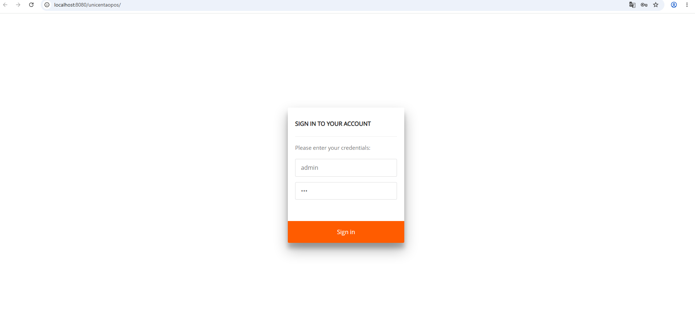](https://www.maravento.com)

<table width="100%">
  <tr>
    <td style="width: 50%; vertical-align: top;">
     Default login credentials:
    </td>
    <td style="width: 50%; vertical-align: top;">
     Credenciales de acceso por defecto:
    </td>
  </tr>
</table>

| Field | Value |
| --- | --- |
| User | <code>admin</code> |
| Password | <code>pwd</code> |

> **Warning:** These are default credentials. Change the password after the first login.
>
> **Advertencia:** Estas son credenciales por defecto. Cambie la contraseña después del primer inicio de sesión.

### DATABASE SETUP

[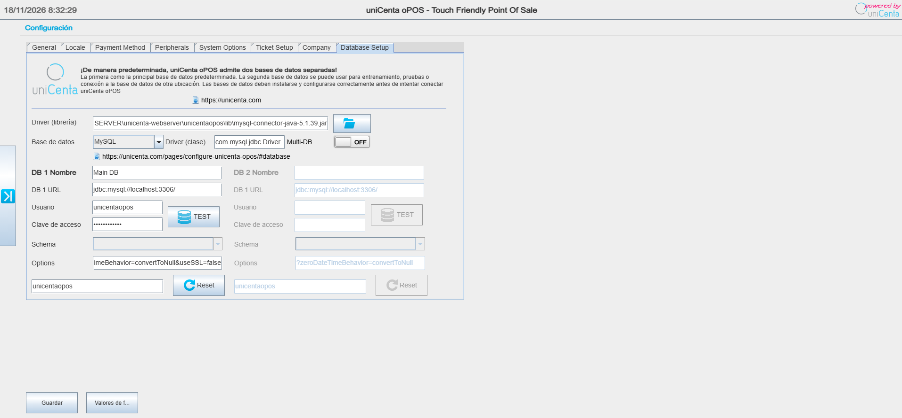](https://www.maravento.com)

<table width="100%">
  <tr>
    <td style="width: 50%; vertical-align: top;">
     The installer creates the empty database <code>unicentaopos</code> (<code>utf8</code> / <code>utf8_general_ci</code>) and its user. uniCenta creates the tables on first start. Use these values in <b>Database Setup</b>:
    </td>
    <td style="width: 50%; vertical-align: top;">
     El instalador crea la base de datos vacía <code>unicentaopos</code> (<code>utf8</code> / <code>utf8_general_ci</code>) y su usuario. uniCenta crea las tablas al iniciar por primera vez. Use estos valores en <b>Database Setup</b>:
    </td>
  </tr>
</table>

| Field | Value |
| --- | --- |
| Driver | <code>C:\uniweb\uniCenta-WEBSERVER\unicenta-webserver\unicentaopos\lib\mysql-connector-java-5.1.39.jar</code> |
| DB 1 URL | <code>jdbc:mysql://localhost:3306/</code> |
| Usuario | <code>unicentaopos</code> |
| Clave de acceso | <code>unicentaopos</code> |
| Schema | <code>unicentaopos</code> |
| Options | <code>?zeroDateTimeBehavior=convertToNull&useSSL=false</code> |

## TREK

---

| File | OS | Size |
| :---: | :---: | :---: |
| [trek.exe (.zip)](https://raw.githubusercontent.com/maravento/vault/master/uniweb/trek/trek.zip) | Windows 10/11 x64 | 3.6 MB |

<table width="100%">
  <tr>
    <td style="width: 50%; vertical-align: top;">
     <b>Trek</b> is a SQL database rescue tool. It is used when there is damage to the software, which prevents it from being exported by traditional methods. Unzip <code>trek.zip</code> to your desktop, run <code>trek.exe</code> with double click (accept privileged execution) and follow the instructions on the screen.
    </td>
    <td style="width: 50%; vertical-align: top;">
     <b>Trek</b> es una herramienta de rescate de bases de datos SQL. Se usa cuando hay daños en el software, que impiden exportarlas por métodos tradicionales. Descomprima <code>trek.zip</code> en el escritorio, ejecute <code>trek.exe</code> con doble clic (acepte la ejecución con privilegios) y siga las instrucciones en pantalla.
    </td>
  </tr>
</table>

> Trek uses batch scripts packaged into a .exe, and antivirus software may flag this as a false positive. If in doubt, you can unzip the .exe and audit the scripts, run the packages manually, or choose not to use it.
>
> Trek usa scripts batch empaquetados en un .exe, y los antivirus pueden detectarlo como falso positivo. Si tiene dudas, puede descomprimir el .exe y auditar los scripts, ejecutar los paquetes manualmente, o no usarlo.

### SCREENS

| Screen | Description | Descripción |
| :---: | --- | --- |
| <a href="https://raw.githubusercontent.com/maravento/vault/master/uniweb/img/trek_selector.png">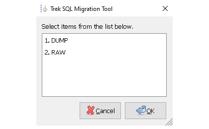</a> | <b>DUMP</b> exports/imports MySQL databases in <code>.sql</code> format. <b>RAW</b> copies the MySQL <code>data</code> folder as is. | <b>DUMP</b> exporta/importa bases de datos MySQL en formato <code>.sql</code>. <b>RAW</b> copia tal cual la carpeta <code>data</code> de MySQL. |
| <a href="https://raw.githubusercontent.com/maravento/vault/master/uniweb/img/trek_dump_ini.png">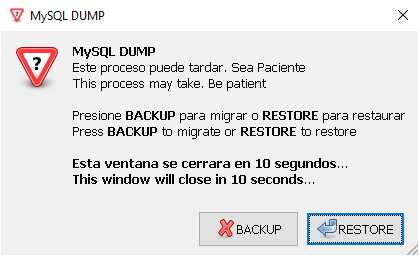</a> | DUMP menu: <b>BACKUP</b> exports a database to <code>.sql</code>. <b>RESTORE</b> imports a <code>.sql</code> file. | Menú DUMP: <b>BACKUP</b> exporta una base de datos a <code>.sql</code>. <b>RESTORE</b> importa un archivo <code>.sql</code>. |
| <a href="https://raw.githubusercontent.com/maravento/vault/master/uniweb/img/trek_dump_backup.png">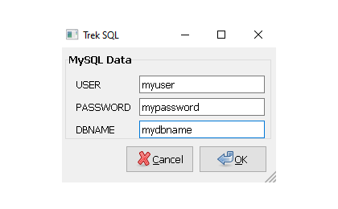</a> | BACKUP: enter user, password and name of the database to export. | BACKUP: escriba usuario, contraseña y nombre de la base de datos a exportar. |
| <a href="https://raw.githubusercontent.com/maravento/vault/master/uniweb/img/trek_dump_backup_end.png">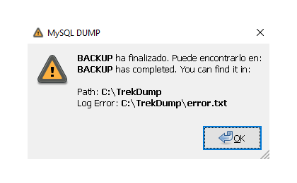</a> | End of BACKUP. Check <code>error.txt</code> for errors. | Fin del BACKUP. Revise <code>error.txt</code> para ver si hubo errores. |
| <a href="https://raw.githubusercontent.com/maravento/vault/master/uniweb/img/trek_dump_path.png">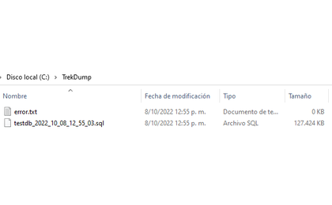</a> | <code>C:\TrekDump</code> keeps every backup, named database-date-time (ex: <code>mydbname_2021_08_26_09_48_26.sql</code>), and <code>error.txt</code>. | <code>C:\TrekDump</code> guarda cada copia, con nombre base-fecha-hora (ej: <code>mydbname_2021_08_26_09_48_26.sql</code>), y <code>error.txt</code>. |
| <a href="https://raw.githubusercontent.com/maravento/vault/master/uniweb/img/trek_sql_file.png">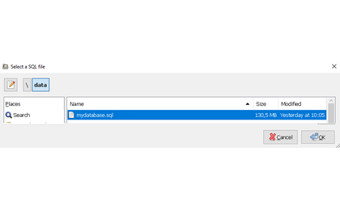</a> | RESTORE: select the <code>.sql</code> file to import. | RESTORE: seleccione el archivo <code>.sql</code> a importar. |
| <a href="https://raw.githubusercontent.com/maravento/vault/master/uniweb/img/trek_dump_restore.png">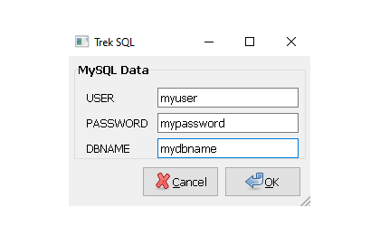</a> | RESTORE: enter user, password and name of the database to import. | RESTORE: escriba usuario, contraseña y nombre de la base de datos a importar. |
| <a href="https://raw.githubusercontent.com/maravento/vault/master/uniweb/img/trek_dump_restore_end.png">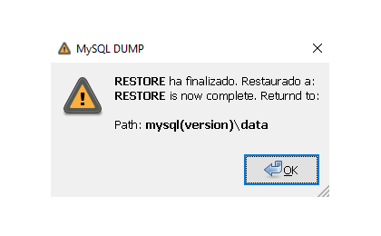</a> | End of RESTORE. | Fin del RESTORE. |
| <a href="https://raw.githubusercontent.com/maravento/vault/master/uniweb/img/trek_dump_warning.png">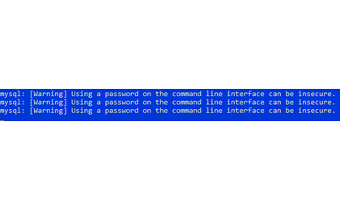</a> | MySQL warning shown during BACKUP or RESTORE, because the password is passed on the command line. It is not an error. | Aviso de MySQL durante BACKUP o RESTORE, porque la contraseña va en la línea de comandos. No es un error. |
| <a href="https://raw.githubusercontent.com/maravento/vault/master/uniweb/img/trek_raw_ini.png">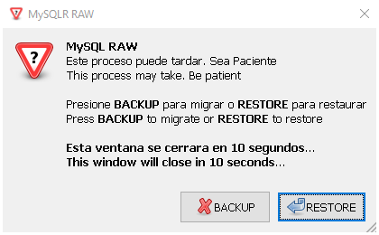</a> | RAW menu: <b>BACKUP</b> copies <code>\mysql-%version%\data</code> to <code>%HOMEDRIVE%\TrekRAW</code>. <b>RESTORE</b> copies it back. | Menú RAW: <b>BACKUP</b> copia <code>\mysql-%version%\data</code> a <code>%HOMEDRIVE%\TrekRAW</code>. <b>RESTORE</b> la copia de vuelta. |
| <a href="https://raw.githubusercontent.com/maravento/vault/master/uniweb/img/trek_raw_folder.png">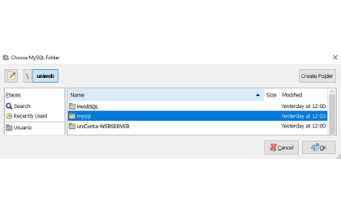</a> | Select the MySQL folder (ex: <code>C:\uniweb\mysql</code>) to run BACKUP or RESTORE. | Seleccione la carpeta de MySQL (ej: <code>C:\uniweb\mysql</code>) para hacer BACKUP o RESTORE. |

#### IMPORTANT BEFORE USE DUMP OPTION

<table width="100%">
  <tr>
    <td style="width: 50%; vertical-align: top;">
     - The MySQL service must be running, before using the DUMP options.
    </td>
    <td style="width: 50%; vertical-align: top;">
     - El servicio de MySQL debe estar ejecutándose, antes de usar las opciones de DUMP.
    </td>
  </tr>
  <tr>
    <td style="width: 50%; vertical-align: top;">
     - To use the DUMP options you must create a username and password with maximum privileges. The use of the <code>root</code> user is not recommended.
    </td>
    <td style="width: 50%; vertical-align: top;">
     - Para utilizar las opciones de DUMP es necesario crear un usuario y contraseña con privilegios máximos. No se recomienda el uso del usuario <code>root</code>.
    </td>
  </tr>
  <tr>
    <td style="width: 50%; vertical-align: top;">
     - The <code>.sql</code> file to be imported must not contain spaces and/or special characters.
    </td>
    <td style="width: 50%; vertical-align: top;">
     - El archivo <code>.sql</code> a importar no debe contener espacios y/o caracteres especiales.
    </td>
  </tr>
  <tr>
    <td style="width: 50%; vertical-align: top;">
     - If the <code>.sql</code> file to import exceeds the maximum size allowed parameter, the error <code>ERROR 2006 (HY000) at line NUMBER: MySQL server has gone away</code> will be output (this will not be displayed in Trek). To fix this, increase the value in the <code>max_allowed_packet</code> parameter of the <code>my.cnf</code> or <code>my.ini</code> file, depending on which stack you are using. Example:
    </td>
    <td style="width: 50%; vertical-align: top;">
     - Si el archivo <code>.sql</code> a importar excede el tamaño máximo permitido saldrá el error <code>ERROR 2006 (HY000) at line NUMBER: MySQL server has gone away</code> (este no se mostrará en Trek). Para solucionarlo, incremente el tamaño máximo permitido en el parámetro <code>max_allowed_packet</code> del archivo <code>my.cnf</code> o <code>my.ini</code>, en dependencia del stack que utilice. Ejemplo:
    </td>
  </tr>
</table>

  ```shell
  max_allowed_packet = 100M
  ```

<table width="100%">
  <tr>
    <td style="width: 50%; vertical-align: top;">
     - If the <code>.sql</code> file to be imported contains a database (CREATE DATABASE statement), a new database will not be created and the existing one will be kept. Otherwise it will be created.
    </td>
    <td style="width: 50%; vertical-align: top;">
     - Si el archivo <code>.sql</code> a importar contiene una base de datos (CREATE DATABASE statement), no se creará una nueva base de datos y se conservará la existente. Caso contrario se creará.
    </td>
  </tr>
</table>

  ```shell
  A database already exists in the file: dbfile.sql
  The database will not be created: dbname
  # or
  There is no database in the file: dbfile.sql
  The database will be created: dbname
  ```

<table width="100%">
  <tr>
    <td style="width: 50%; vertical-align: top;">
     - MySQL will display a warning notice during the process. This is because you entered the password on the command line to be able to do the BACKUP or RESTORE.
    </td>
    <td style="width: 50%; vertical-align: top;">
     - MySQL mostrará un aviso de advertencia durante el proceso. Esto se debe a que introdujo la contraseña en línea de comandos para poder hacer el BACKUP o RESTORE.
    </td>
  </tr>
</table>


#### MOST COMMON PATHS TO MYSQL FOLDER

```shell
Wamp: \wamp64\bin\mysql\mysql(version)
Xampp: \xampp\mysql
UZero: \UniServerZ\core\mysql
Uniweb: \uniweb\mysql
MySQL (Community Server .msi): \Program Files\MySQL\MySQL Server(version)
```

#### IMPORTANT BEFORE USE RAW OPTION

<table width="100%">
  <tr>
    <td style="width: 50%; vertical-align: top;">
     - When you finish running BACKUP or RESTORE, you must start MySQL Server service manually. In Uniweb, use option <b>1 Start Services</b> of the <code>uniweb</code> shortcut.
    </td>
    <td style="width: 50%; vertical-align: top;">
     - Al terminar la ejecución de BACKUP o RESTORE, usted debe iniciar el servicio MySQL Server manualmente. En Uniweb, use la opción <b>1 Start Services</b> del acceso directo <code>uniweb</code>.
    </td>
  </tr>
  <tr>
    <td style="width: 50%; vertical-align: top;">
     - When using the BACKUP or RESTORE options, when they finish, you should refer to the <code>Trek.txt</code> file on your desktop.
    </td>
    <td style="width: 50%; vertical-align: top;">
     - Al usar las opciones BACKUP o RESTORE, cuando finalicen, debe consultar el archivo <code>Trek.txt</code> en su escritorio.
    </td>
  </tr>
  <tr>
    <td style="width: 50%; vertical-align: top;">
     - Do not use this tool to migrate or restore databases with different structures.
    </td>
    <td style="width: 50%; vertical-align: top;">
     - No use esta herramienta para migrar o restaurar bases de datos con estructuras diferentes.
    </td>
  </tr>
  <tr>
    <td style="width: 50%; vertical-align: top;">
     - MySQL RAW option uses the <a href="https://es.wikipedia.org/wiki/Robocopy" target="_blank">Robust File Copy</a> tool, which has some limitations and may not obtain the desired results. Use at your own risk.
    </td>
    <td style="width: 50%; vertical-align: top;">
     - La opción MySQL RAW utiliza la herramienta <a href="https://es.wikipedia.org/wiki/Robocopy" target="_blank">Robust File Copy</a>, la cual tiene algunas limitaciones y puede no obtener los resultados deseados. Úsela bajo su propio riesgo.
    </td>
  </tr>
  <tr>
    <td style="width: 50%; vertical-align: top;">
     - MySQL RAW option excludes SSL related files (.pem), because these are unique, so after using the RESTORE option, you may have issues with access or content if it was encrypted with an SSL certificate. More information <a href="https://dba.stackexchange.com/a/267757/208609" target="_blank">HERE</a>.
    </td>
    <td style="width: 50%; vertical-align: top;">
     - La opción MySQL RAW excluye los archivos relacionados con SSL (*.pem), debido a que estos son únicos, por tanto después de usar la opción RESTORE, puede tener problemas con el acceso o contenido si estaba cifrado con un certificado SSL. Más información <a href="https://dba.stackexchange.com/a/267757/208609" target="_blank">AQUI</a>.
    </td>
  </tr>
  <tr>
    <td style="width: 50%; vertical-align: top;">
     - When you start Trek, it automatically creates the TrekRAW folder on your HOMEDRIVE (ex: <code>c:\TrekRAW</code>). All actions are performed within this folder (BACKUP or RESTORE), therefore your input or output files should be in this folder.
    </td>
    <td style="width: 50%; vertical-align: top;">
     - Cuando inicia Trek, automáticamente crea la carpeta TrekRAW en su HOMEDRIVE (ej: <code>c:\TrekRAW</code>). Todas las acciones se realizan dentro de esta carpeta (BACKUP o RESTORE), por tanto sus archivos de entrada o salida, deberán estar en esta carpeta.
    </td>
  </tr>
</table>

## PACKAGES AND TOOLS

---

- [uniCenta oPOS](https://unicenta.com)
- [MySQL Community Server](https://downloads.mysql.com/archives/community/)
- [HeidiSQL](https://www.heidisql.com/)
- [Java SE Runtime Environment 8](https://www.java.com/)
- [Visual C++ Redistributable AIO](https://github.com/abbodi1406/vcredist)
- [7zSFX Builder](https://sourceforge.net/projects/s-zipsfxbuilder/)
- [MySQL Dump](https://dev.mysql.com/doc/refman/8.0/en/mysqldump.html)
- [Resource Turner](http://www.restuner.com/)
- [Robust File Copy](https://docs.microsoft.com/en-us/windows-server/administration/windows-commands/robocopy)
- [stahlworks ZipUnzip](http://stahlworks.com/dev/index.php?tool=zipunzip)
- [WinZenity](https://github.com/maravento/vault/tree/master/winzenity)

## EOL | EOS

---

<table width="100%">
  <tr>
    <td style="width: 50%; vertical-align: top;">
     This project has reached End-of-Life (EOL) and End-of-Support (EOS). No longer supported or updated.
    </td>
    <td style="width: 50%; vertical-align: top;">
     Este proyecto ha alcanzado el fin de vida (EOL) y el fin de soporte (EOS). Ya no cuenta con soporte o actualizaciones.
    </td>
  </tr>
</table>

## NOTICE

---

<table width="100%">
  <tr>
    <td style="width: 50%; vertical-align: top;">
      <strong>This repository</strong>
      <ul>
        <li>May include third-party components.</li>
        <li>Does not accept Pull Requests. Changes must be proposed via Issues.</li>
      </ul>
    </td>
    <td style="width: 50%; vertical-align: top;">
      <strong>Este repositorio</strong>
      <ul>
        <li>Puede incluir componentes de terceros.</li>
        <li>No acepta Pull Requests. Los cambios deben proponerse mediante Issues.</li>
      </ul>
    </td>
  </tr>
</table>

## DISCLAIMER

---

THE SOFTWARE IS PROVIDED "AS IS", WITHOUT WARRANTY OF ANY KIND, EXPRESS OR IMPLIED, INCLUDING BUT NOT LIMITED TO THE WARRANTIES OF MERCHANTABILITY, FITNESS FOR A PARTICULAR PURPOSE AND NONINFRINGEMENT. IN NO EVENT SHALL THE AUTHORS OR COPYRIGHT HOLDERS BE LIABLE FOR ANY CLAIM, DAMAGES OR OTHER LIABILITY, WHETHER IN AN ACTION OF CONTRACT, TORT OR OTHERWISE, ARISING FROM, OUT OF OR IN CONNECTION WITH THE SOFTWARE OR THE USE OR OTHER DEALINGS IN THE SOFTWARE.
